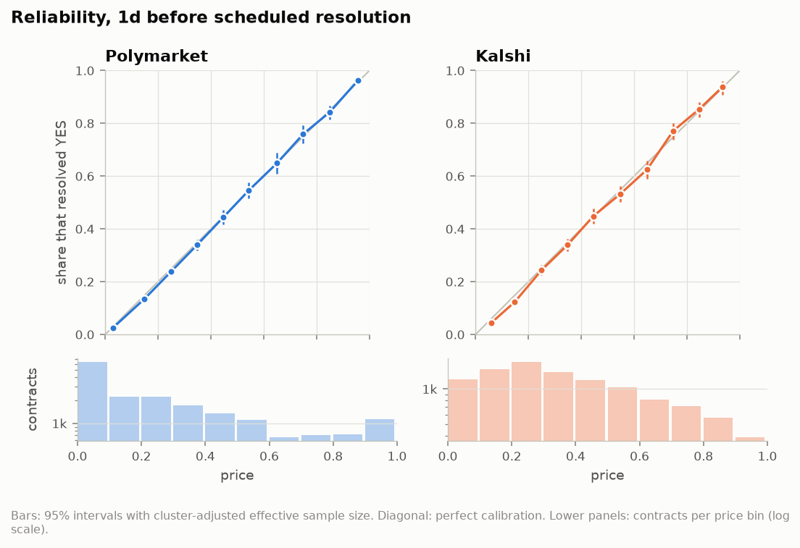
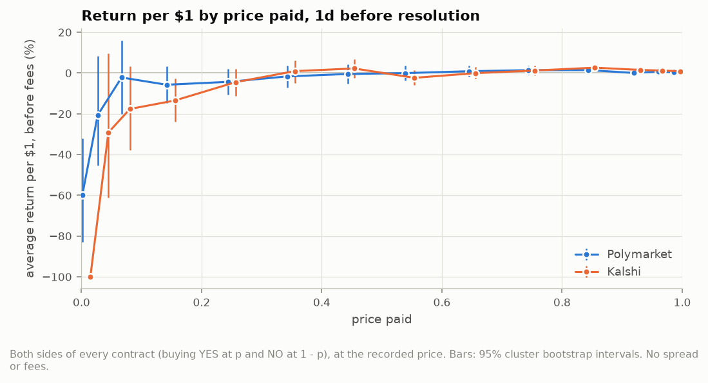
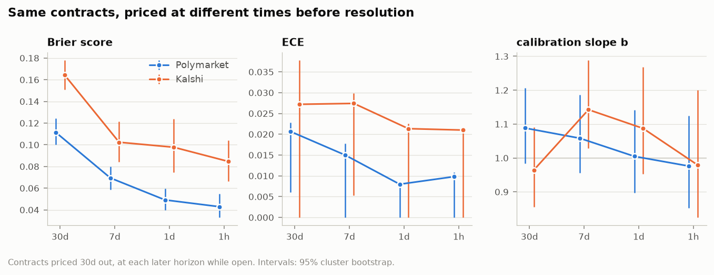
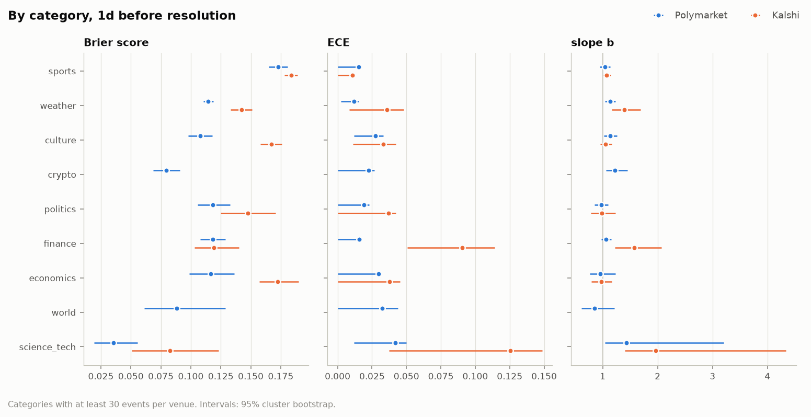
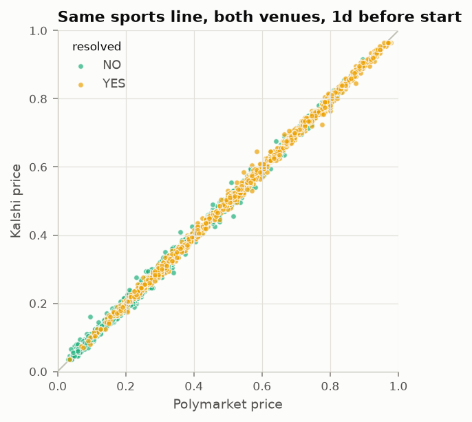
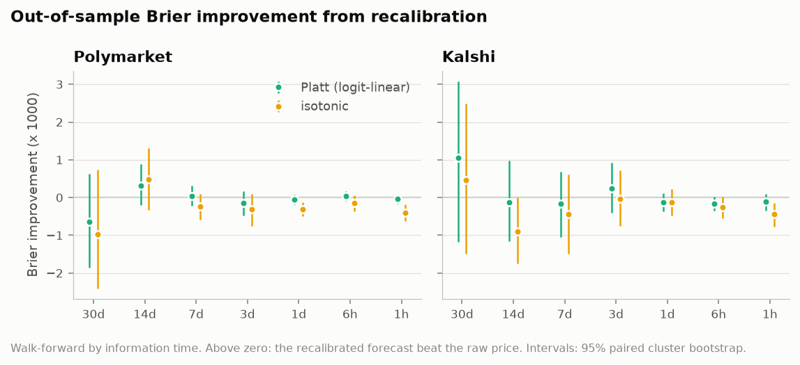

# pm-calibration

A calibration study of prediction market prices on Polymarket and Kalshi, built only from their public APIs. It asks whether a contract trading at 70% resolves YES about 70% of the time, and checks every forecast against a price that existed before the outcome was known.

I kept seeing "prediction markets are well calibrated" charts with one or two of the same problems. They take the price at a fixed time before the market *actually* closed, which for markets that resolve early means picking the snapshot with the outcome. They use the last trade of a market that hadn't traded for days. Or they only keep markets above some volume, and volume comes after the price you are scoring. I wanted to see what the answer looks like with those holes closed, on 2026 data from both venues.

Short version of what I found:

- **Where there was a real two-sided market, prices were close to calibrated on both venues.** One day before scheduled resolution, the logistic calibration slope is b = 1.05 [1.01, 1.10] on Polymarket, across 18,228 contracts, and 1.06 [1.01, 1.11] on Kalshi, across 10,477. The intercept is −0.01 [−0.05, 0.03] and −0.03 [−0.08, 0.03]. A slope of 1 and intercept of 0 is perfect calibration. The reliability term of the Brier score is indistinguishable from zero on both.
- **There is a small favourite-longshot bias, and it lives at the cheap end.** A slope a little above 1 means cheap contracts are slightly overpriced and expensive ones slightly underpriced. Both slopes exclude 1 at the usual 95% level but not at 99.5%, the level I set in advance for my ten primary comparisons, so this is suggestive rather than settled. Buying contracts priced 2 to 5 cents lost about 21% per dollar on Polymarket and 29% on Kalshi at the mid, before fees, with wide intervals. Above 20 cents the average return is within 5% of zero on both venues.
- **Thin markets lean towards YES.** Where the only price was the last trade, because nobody was quoting a tight market, YES was overpriced: intercept −0.21 [−0.28, −0.15] on Polymarket and −0.47 [−0.56, −0.38] on Kalshi. In those markets the last print is often someone buying at a wide ask.
- **Prices get sharper as resolution approaches, and stay about as calibrated.** On the same contracts, the Brier score falls from 0.112 thirty days out to 0.049 one day out on Polymarket, and from 0.165 to 0.098 on Kalshi. The slope and intercept show no consistent change over the same span.
- **The two venues price the same sports line the same way.** On 2,840 sports lines listed on both and priced at the same moment one day before the start, the median price difference is half a cent, and the Brier scores differ by 0.0002 [−0.0001, 0.0005].
- **There is nothing for a simple recalibration to fix.** Walk-forward, refitting weekly on markets that had already resolved, the out-of-sample change in Brier score from Platt scaling has an interval containing zero at every horizon on both venues, and at 1 day out it is under 0.1%. Isotonic regression made it slightly worse.
- **How the sample is built moves the answer more than any of the above.** Keeping only markets with $10k of lifetime volume turns Kalshi's intercept to +0.38. Anchoring on the actual close instead of the scheduled time turns the intercept of early-closing Polymarket markets to +0.65. Scoring stale prices as if they were live makes Polymarket look like it overprices YES, with an intercept of −0.28.

## Contents

- [The data](#the-data)
- [From a price history to a forecast](#from-a-price-history-to-a-forecast)
- [Statistics](#statistics)
- [Results](#results)
- [Three ways to get a different answer](#three-ways-to-get-a-different-answer)
- [What I take from this](#what-i-take-from-this)
- [Limitations](#limitations)
- [Quickstart](#quickstart)
- [Layout](#layout)
- [Tests](#tests)

## The data

Everything comes from public endpoints, with no accounts, keys or wallets:

| venue | metadata | prices | trades |
| :--- | :--- | :--- | :--- |
| Polymarket | Gamma `/markets/keyset` and `/events` | CLOB `/prices-history`, daily for the whole life plus 10-minute points for the last 8 days | data-api `/trades`, one 24-hour window per snapshot |
| Kalshi | `/series`, `/events` with nested markets, `/historical/markets` | hourly candlesticks per market, live and historical tiers | not needed, the candles carry volume and bid/ask |

The study covers markets scheduled to resolve between 1 January and 30 September 2026.

Both venues are much bigger than I expected. Polymarket closed about 26,000 markets with at least $1k of volume in a single September week, and Kalshi settled more than 3,000 markets in one hour, mostly hourly strike ladders. Listing everything and downloading every price history would have taken days, so the study works from a sampling frame and an event-level sample:

| | Polymarket | Kalshi |
| :--- | ---: | ---: |
| contracts in the frame | 1,331,687 | 1,949,423 |
| events in the frame | 193,923 | 347,234 |
| contracts sampled by design | 109,720 | 45,460 |
| events sampled by design | 17,797 | 10,533 |
| extra contracts matched across venues | 8,585 | 8,829 |

The frame is every market that resolved, traded at least once, and had its scheduled resolution time in the window. Three kinds are left out on purpose:

- Short-duration crypto markets, the 5-minute and 15-minute up/down markets and anything else in a crypto series that recurs more often than daily. These are a separate study, and there are hundreds of thousands of them.
- Kalshi's hourly and 15-minute series and its multivariate combo markets.
- Markets that only opened at or after their scheduled time, such as in-play props. No snapshot can exist before such a market opened.

The sample is drawn by event, so a multi-outcome event is in or out as a whole. Each recurring series, such as a sports league, a city's daily temperature or a daily index range, is capped at 3 events per calendar month on Polymarket and 1 on Kalshi, chosen by a seeded hash, and events outside any series are all kept. Within a sampled event at most 12 contracts are kept on Polymarket and 6 on Kalshi, again at random. Kalshi gets the tighter caps because it lists thousands of small series, one per team, player or city, and its public API allows about 4 requests a second. Each contract's inclusion probability is stored, so population-weighted estimates are in the robustness table. The headline numbers are unweighted, which means they describe a population where no single series can dominate.

A contract is one binary claim priced on its YES side. For Polymarket markets whose two outcomes are team names or Over/Under rather than Yes/No, the side is chosen by a hash of the market id, so a habit like listing the favourite first can't bias anything.

The pipeline downloaded about 580,000 responses over roughly ten hours at polite rates, with the two venues running in parallel, and caches every one on disk. With `PMCAL_OFFLINE=1` it rebuilds everything from that cache and fails on any miss.

## From a price history to a forecast

This is the part that decides whether the numbers mean anything, so here is each rule and why.

**Anchor on the scheduled time, not the close.** A snapshot at horizon h is the price at t = scheduled time − h. The scheduled time is fixed before the outcome: the game's start for sports on both venues, otherwise the scheduled end. Kalshi's `expected_expiration_time` turned out to be unreliable as a schedule. It is sometimes the deadline plus a settlement buffer, and for games it is the start plus three hours. So the Kalshi pipeline uses a precedence of game and event start times, strike dates, and expected expiration only where it is a real time. Anchoring on the actual close instead would pick, for a "will X happen by December" market that resolved YES in March, a price from February, and for one that resolved NO, a price from late December. That is choosing the snapshot time with the outcome.

**Only while the market was open.** A snapshot needs open ≤ t < actual close. Whether a market is still open at t is known at t, so this filter conditions on nothing from the future. It does change the population: by the 1-day horizon, markets that already resolved early are gone.

**Only prices from at or before t.** The snapshot uses the last observation at or before t, and rejects it if it is older than h/4, clamped to between one hour and one day.

**Only prices someone could trade near.** A price needs evidence of a live market at t. I first tried a looser rule, and it was wrong, which is how I ended up with this one:

- On Kalshi the hourly candles give the best bid and ask. A snapshot counts as a confirmed quote if the spread is tight on the log-odds scale, logit(ask) − logit(bid) ≤ 0.402. That is a 10-cent spread at even odds, about 2 cents at 5%, and well under a cent at 1%. Measuring tightness this way matters in the tails, where a 10-cent spread on a 3-cent contract is no market at all. The price is the mid. Kalshi only emits a candle for an hour in which something changed, so quiet hours carry the last quote forward.
- Polymarket's price history is the plain order-book midpoint, with no spread, even when the book is 0.01/0.99. In thin markets it reads 0.50 and moves whenever anyone posts a far-off quote. Before I caught this, markets with under $100 of lifetime volume had an average price of 0.34 against a YES rate of 0.21, and 14% of them sat within half a cent of 0.50. So on Polymarket a confirmed quote needs a trade in the previous 24 hours, and the midpoint has to lie within half that log-odds width of the trade.
- Where there was no tight quote but there was a trade in the previous 24 hours, the snapshot is priced at that trade and labelled a last-trade price. These are analysed separately. Anything else is stale and dropped.

**No lifetime volume floor.** My first frame kept only markets with at least $1k of volume, a common choice. A review of the first results showed why that's a mistake. Lifetime volume includes everything traded after the snapshot, and upsets attract volume, so the floor selects on the outcome. In some multi-outcome events it dropped the winner. The frame now only requires that a market traded at all, and liquidity enters through what was known at t: whether there was a tight quote, and how much traded in the previous 24 hours.

**Voided and split markets.** Polymarket's 50-50 resolutions and Kalshi's scalar settlements of cancelled events have no binary outcome. They are 202 and 285 of the sampled contracts, and they are counted and dropped.

**Multi-outcome events.** Each outcome is its own binary contract, but outcomes of one event are not independent: exactly one resolves YES. So the bootstrap resamples whole clusters, never single contracts.

## Statistics

For each venue and horizon:

- **Brier score and its decomposition.** With prices binned into ten bins, the Brier score splits into reliability, which measures miscalibration; resolution, which measures how far the prices separate outcomes; and uncertainty, the variance of the base rate. Two within-bin terms make the identity exact. Plug-in reliability is biased upwards in finite samples, so the tables report a debiased version that subtracts each bin's sampling variance. It is about zero for calibrated prices.
- **ECE**, the average gap between a bin's mean price and its YES rate, weighted by count. It is reported next to its noise floor, the ECE you would expect from perfectly calibrated prices with the same distribution, because plug-in ECE is never zero.
- **Calibration regression**, logit P(YES) = a + b · logit(price). b > 1 means prices are too close to 0.5, which is a favourite-longshot bias. a < 0 means the YES side is overpriced at every price. I fit a and b together on the contracts as listed. Fitting b alone on a symmetrised sample, which is the textbook way, folds any YES lean into b. In a simulation with no longshot bias and only a YES lean, it reported b = 1.09.
- **Intervals** come from a cluster bootstrap with 1,000 draws. A cluster is a game, when a venue splits one game over several events, or an event. Clusters in the same category whose deadlines fall on the same UTC day are merged, because they share common shocks: one bitcoin path, one news day, one slate of games. That roughly doubles the width of the Brier intervals compared with event clusters.
- **Pairing.** Comparisons between horizons, venues and recalibration methods reuse the same bootstrap draws on both sides, so the interval on a difference is paired.

The horizon comparison needs care. Requiring a price at every horizon from 30 days down to 1 hour keeps only markets that didn't resolve early, and for "by date" markets resolving early mostly means YES. So the population is fixed by a confirmed quote 30 days out, and each contract is re-scored at 7 days, 1 day and 1 hour with whatever live price it had then, while it was still open.

I fixed ten primary estimands before the final run: for each venue, at the 1-day horizon, b, a, debiased reliability, the Brier change from 30 days to 1 day, and the Platt recalibration gain. For those, `results/summary.json` and the tables also have 99.5% intervals, the Bonferroni level for ten tests, computed from the bootstrap standard error because 1,000 draws can't place a 0.25% quantile. At that level only the two Brier improvements exclude zero. The slopes come out at [0.99, 1.12] for Polymarket and [0.99, 1.14] for Kalshi. Everything else in the tables is exploratory, and with dozens of categories, horizons and buckets some intervals will exclude the reference value by chance.

## Results

The full tables, with every horizon and more breakdowns, are in [`results/report.md`](results/report.md). The CSV behind every figure is in [`results/tables`](results/tables).

### 1. Calibration

One day before scheduled resolution, confirmed quotes only:

| | Polymarket | Kalshi |
| :--- | ---: | ---: |
| contracts | 18,228 | 10,477 |
| clusters | 1,588 | 1,005 |
| YES rate | 0.298 | 0.393 |
| mean price | 0.303 | 0.401 |
| Brier score | 0.121 [0.118, 0.125] | 0.171 [0.167, 0.175] |
| reliability, debiased | 0.0000 [−0.0002, 0.0001] | 0.0001 [−0.0002, 0.0003] |
| resolution | 0.087 | 0.067 |
| ECE / ECE if perfectly calibrated | 0.0067 / 0.0065 | 0.0133 / 0.0099 |
| slope b | 1.05 [1.01, 1.10] | 1.06 [1.01, 1.11] |
| intercept a | −0.01 [−0.05, 0.03] | −0.03 [−0.08, 0.03] |



In every price decile the YES rate is within 1.4 percentage points of the average price on Polymarket and within 2.5 on Kalshi. Polymarket's ECE is at its noise floor, and Kalshi's is a little above it. The Brier scores differ a lot between venues, but that is the mix of markets, not skill: Kalshi's confirmed quotes are more often near-coin-flip sports lines, and the uncertainty term of the Brier score is larger when outcomes are closer to 50/50. The cross-venue section below compares like with like.

The other horizons look much the same. Across 30, 14, 7, 3 and 1 days, 6 hours and 1 hour, b stays between 0.96 and 1.11 and a between −0.17 and +0.03. The one consistent difference is on Kalshi, where the intercept is about −0.1 from 30 days down to 3 days, with intervals that exclude zero at 30, 7 and 3 days: a mild YES lean far from resolution that is gone by the last day.

### 2. Favourite-longshot bias

The slope says prices are a little too close to 0.5. The return table says where that comes from. These are the average returns from buying every contract in a price bin, YES at p and NO at 1 − p, at the quoted mid, before spread and fees:

| price paid | Polymarket | Kalshi |
| :--- | ---: | ---: |
| 0 to 2c | −60% [−83, −32] | too few |
| 2 to 5c | −21% [−45, +8] | −29% [−61, +10] |
| 5 to 10c | −2% [−20, +16] | −18% [−38, +3] |
| 10 to 20c | −6% [−15, +3] | −14% [−24, −3] |
| 20 to 80c | within ±5% | within ±5% |
| 80 to 95c | +0 to +1% | +1.5 to +2.6% |
| 95 to 100c | +0.4 to +0.7% | +0.9 to +1.2% |



So the textbook favourite-longshot bias is there: long shots lose money and favourites make a little. It is confined to contracts under about 20 cents, and the intervals there are wide because cheap contracts rarely win. The two halves of the table are mirror images of each other, the same contracts bought from the other side, so they are not independent evidence. Two caveats keep me from reading much into the cheap end:

- The returns are at the mid. For a 3-cent contract on a 1-cent tick, half a cent of spread is a sixth of the price. On Kalshi, where the bid is known, the loss shrinks at the bid: from −29% to −19% at 2 to 5 cents, from −18% to −9% at 5 to 10 cents, and from −14% to −7% at 10 to 20 cents.
- Below about 2 cents, prices sit at the venue's minimum tick. Of Kalshi's live prices under 2 cents, 93% were exactly 1 cent, which is why almost none of them pass the tight-quote test. A contract whose fair value is 0.3% cannot trade at its fair value there.

The YES lean shows up only in thin markets:

| one day out | contracts | slope b | intercept a |
| :--- | ---: | ---: | ---: |
| Polymarket, confirmed quote | 18,228 | 1.05 [1.01, 1.10] | −0.01 [−0.05, 0.03] |
| Polymarket, last trade | 36,410 | 0.95 [0.92, 0.98] | −0.21 [−0.28, −0.15] |
| Kalshi, confirmed quote | 10,477 | 1.06 [1.01, 1.11] | −0.03 [−0.08, 0.03] |
| Kalshi, last trade | 9,252 | 0.99 [0.94, 1.05] | −0.47 [−0.56, −0.38] |

A last-trade price is what you would see on a market page for a thin market, and in those markets YES is overpriced at every price level. Among Kalshi's last-trade rows, 52% of the trades were at or above the standing ask, and 37% of the books had no bid at all. The price there records what an eager YES buyer paid, not what the market thought.

### 3. Time to resolution

The 3,197 Polymarket and 2,702 Kalshi contracts that had a confirmed quote 30 days before their scheduled time, scored again as resolution approached:



| | 30 days | 7 days | 1 day | 1 hour |
| :--- | ---: | ---: | ---: | ---: |
| Polymarket Brier | 0.112 | 0.069 | 0.049 | 0.043 |
| Kalshi Brier | 0.165 | 0.102 | 0.098 | 0.085 |
| Polymarket slope b | 1.09 | 1.06 | 1.00 | 0.98 |
| Kalshi slope b | 0.96 | 1.14 | 1.09 | 0.98 |

The Brier score improves by 0.062 [0.048, 0.075] on Polymarket and 0.067 [0.042, 0.091] on Kalshi between 30 days and 1 day out. These are the only primary estimands that clear the 99.5% level. Almost all of that is resolution: prices move towards the eventual outcome as information arrives. Calibration doesn't change in a way I can detect. Of the twelve slope and intercept changes from the 30-day value, only Kalshi's slope at 7 days excludes zero. The population shrinks over time, to 1,751 and 748 contracts at 1 hour, because markets close or stop trading. Both happen in ways known at the time, so it doesn't bias these numbers, but it does make the late horizons noisier.

### 4. Category, liquidity and venue



The biggest departures from b = 1 are in strike ladders. Kalshi's weather markets, b = 1.39 [1.17, 1.69], and finance markets, b = 1.58 [1.22, 2.07], are ranges and thresholds on one underlying number, and so is Polymarket's crypto category, b = 1.23 [1.06, 1.45]. In a ladder the cheap rungs far from the current value are overpriced and the likely rungs underpriced, which is a favourite-longshot bias inside each event. Sports, politics and economics sit close to b = 1 on both venues. Culture leans towards YES on Kalshi, with a = −0.17 [−0.29, −0.06]. Much of that category is "will X say Y" mention markets. These are exploratory: there are 16 venue-category cells, and I would expect one to look odd by chance.

Liquidity measured at the time of the snapshot makes little difference among confirmed quotes. On both venues, markets with heavy trading in the previous 24 hours and markets with a little trading have slopes and intercepts within each other's intervals. Lifetime volume tells a different story, but for the wrong reason, which is in the next section.

**The same proposition on both venues.** The matching step found 155,880 pairs of contracts listed on both venues, by league, start time and team names for games, and by exact bracket, strike and date for Fed decisions, CPI prints, elections, awards and golf. I read 285 pairs side by side with both venues' resolution rules and found one error, a class of pairing I then excluded. Of the resolved pairs, 99.99% resolved the same way on both venues. The handful that disagreed were mostly soccer spreads and totals that one venue settled on a different score.

A subset of these pairs, with both contracts downloaded and both priced at the same moment with a confirmed quote:

| one day out | pairs | clusters | Polymarket Brier | Kalshi Brier | Kalshi − Polymarket | median price gap |
| :--- | ---: | ---: | ---: | ---: | ---: | ---: |
| sports lines | 2,840 | 998 | 0.1935 | 0.1937 | +0.0002 [−0.0001, +0.0005] | 0.5c |
| golf, awards, elections, macro | 185 | 102 | 0.1147 | 0.1130 | −0.0017 [−0.0044, +0.0008] | 1.0c |



On sports the two venues are, for practical purposes, one market. Only 0.2% of pairs differed by 5 cents or more. The equal Brier scores follow from the equal prices, so the right reading is that the venues price sports the same, not that they are equally good forecasters by some independent measure. The other families are too few to say much. Before I applied the same price rule to both sides of each pair, Kalshi looked clearly better on golf and awards. That difference came from midpoints in thin Polymarket golf books.

### 5. Recalibration

If prices were systematically off, a map learned from past markets should improve future ones. I fitted two: Platt scaling, a logistic regression of the outcome on logit(price), and isotonic regression, with block values shrunk towards the price where data are thin. Each is refitted every 7 days on contracts that had resolved by then, and applied only to snapshots taken after the refit. Splitting by resolution date alone wouldn't be enough: a 30-day-ahead snapshot is taken a month before its own resolution, when outcomes that resolved in between were still unknown.



Platt scaling's gain is within ±0.7% of the raw Brier score at every horizon on both venues, and its interval includes zero everywhere. At 1 day out it is −0.04% on Polymarket and −0.08% on Kalshi. Isotonic regression is slightly but significantly worse than the raw price close to resolution, by 0.25 to 0.3% at 1 day and 1 hour on Polymarket and at 1 hour on Kalshi. A slope of 1.05 is too small a distortion for a recalibration fitted on a few thousand past markets to correct without adding more noise than it removes.

## Three ways to get a different answer

These come from the robustness table in [`results/report.md`](results/report.md), one day out unless stated:

| variant | venue | contracts | slope b | intercept a |
| :--- | :--- | ---: | ---: | ---: |
| main: confirmed quotes | Polymarket | 18,228 | 1.05 [1.01, 1.10] | −0.01 [−0.05, 0.03] |
| main: confirmed quotes | Kalshi | 10,477 | 1.06 [1.01, 1.11] | −0.03 [−0.08, 0.03] |
| lifetime volume ≥ $10k | Polymarket | 8,948 | 0.92 [0.87, 0.98] | +0.09 [0.03, 0.14] |
| lifetime volume ≥ $10k | Kalshi | 3,397 | 0.72 [0.64, 0.81] | +0.38 [0.29, 0.46] |
| anchored on actual close, early closers | Polymarket | 15,686 | 1.43 [1.34, 1.56] | +0.65 [0.39, 0.96] |
| stale prices included | Polymarket | 86,216 | 1.13 [1.10, 1.16] | −0.28 [−0.32, −0.23] |
| stale prices included | Kalshi | 27,253 | 1.06 [1.02, 1.10] | −0.15 [−0.20, −0.10] |

**A lifetime volume floor.** Restricting to markets that traded $10k over their life makes YES look underpriced, with a = +0.38 on Kalshi, and makes the slope fall well below 1. The markets that end up with a lot of volume are disproportionately the ones where something surprising happened. On Kalshi the effect is stronger because dollar volume is contracts times price, and a contract that is heading to $1 trades at high prices late in its life. The same mechanism makes lifetime volume buckets useless for the liquidity question: on Kalshi the YES rate in the $100k to $1M bucket is 0.62 against an average price of 0.47.

**Anchoring on the close.** Markets that closed more than a day before their scheduled time have no 1-day snapshot under the scheduled anchor, because by then they were closed. Anchoring on the actual close brings them back in, priced one day before they closed. On Polymarket those prices underprice YES by a wide margin, with an intercept of +0.65. Markets that close early are mostly "by date" markets where the event happened, and the day before it happened the price was still low.

**Stale prices.** Treating every last print as a price, including ones days old, gives Polymarket an intercept of −0.28: YES apparently overpriced across the board. That is mostly thin markets with an empty book, whose midpoint sits near 0.50 whatever the odds.

Other checks that don't change the main result: weighting each event once instead of each contract, which gives b = 1.06 on both venues, keeping only binary markets or only multi-outcome events, dropping prices below 2c or above 98c, using the last trade instead of the mid in markets that traded in the previous hour, and coarser or finer bootstrap clusters. Population weighting does move Polymarket, to b = 0.85 [0.75, 0.96], because the weights put most of the mass on sports, where a handful of very active series carry very large weights. The design effect of those weights is about 11, so the weighted estimate has the precision of roughly 1,700 contracts, and I don't lean on it.

## What I take from this

1. When there is a real market, with someone quoting both sides close together, prediction market prices in 2026 are close to calibrated on both venues, one day out and thirty. The remaining distortion is a small favourite-longshot bias, mostly in contracts under 20 cents, and on Kalshi between a third and a half of it is the spread itself.
2. Where a YES lean shows up in this data, it is a thin-market effect. A market page showing the last trade of an illiquid contract is showing what an eager buyer paid.
3. Most of the work in a study like this is deciding what counts as a price and which markets count at all. Three common shortcuts each move the intercept by more than the effect being measured.
4. Polymarket and Kalshi agree to within half a cent on the same sports line. Whatever separates them in the per-venue tables is the mix of markets each lists.

## Limitations

- **One window.** Nine months of 2026. The walk-forward needs a few weeks of resolved markets before its first refit, which leaves the 30-day Polymarket recalibration with only 140 test clusters.
- **The sample is capped.** The headline describes a population where each series contributes at most a few events a month. Population-weighted estimates are noisier and lean towards sports.
- **Different rules on each venue.** Kalshi gives bid and ask; Polymarket gives a midpoint and trades. The confirmed-quote rules are meant to say the same thing, but 25% of Kalshi's confirmed quotes had no trade in the previous day, which the Polymarket rule cannot allow. Per-venue numbers are not a venue comparison; the matched pairs are.
- **Returns ignore costs.** Every return is at the mid, before spread and fees. Kalshi's fees are largest in relative terms on cheap contracts.
- **Anchors come from today's metadata.** Polymarket's end dates and game start times are the current values, so postponements and edits are applied after the fact.
- **Some markets are missing.** About 0.3% of non-crypto Polymarket markets with null volume in Gamma had in fact traded, and are not in the frame. Kalshi series that are hourly today but listed daily markets earlier in 2026 are skipped whole.
- **ECE in the tails.** Ten equal bins put everything from 0 to 10 cents in one bin, so a low ECE says little about the tails. The return table and the slope are the better guides there.

## Quickstart

You need [uv](https://docs.astral.sh/uv/). The tests are offline and take about 20 seconds:

```bash
uv sync
PMCAL_OFFLINE=1 uv run pytest
```

Reproducing the study from scratch downloads about 6 GB into `data/`, which is ignored by git. At the default rates it took about ten hours with the two venues in parallel, mostly waiting on Kalshi's 4 requests a second and Polymarket's trade endpoint:

```bash
uv run pmcal index  --venue all     # list the sampling frame (metadata only)
uv run pmcal match                  # pair the same proposition across venues
uv run pmcal sample --venue all     # draw the event-level sample, plus matched contracts
uv run pmcal prices --venue all     # price histories and trade windows into the cache
PMCAL_OFFLINE=1 uv run pmcal build --venue all   # snapshots, from cache only
PMCAL_OFFLINE=1 uv run pmcal match               # cross-venue snapshots
PMCAL_OFFLINE=1 uv run pmcal report              # results/: tables, figures, report.md
```

`pmcal report --quick` uses 100 bootstrap draws instead of 1,000 and takes about five minutes. The configuration is [`configs/main.toml`](configs/main.toml). Unknown keys are errors, so a typo cannot fall back to a default:

```toml
[study]
start = "2026-01-01"
end = "2026-09-30"

[frame]
min_volume_usd = 0.0          # traded at all; see "No lifetime volume floor"

[sample]
max_events_per_series_month = 3
max_contracts_per_event = 12

[sample.venue.kalshi]
max_events_per_series_month = 1
max_contracts_per_event = 6

[analysis]
cluster_by = ["category_day"]
```

Local checks match CI:

```bash
uv run ruff check
uv run ruff format --check
uv run mypy
PMCAL_OFFLINE=1 uv run pytest
```

## Layout

```
src/pmcal/
  venues/polymarket.py   Gamma listing, CLOB price history, trade windows, outcomes, anchors
  venues/kalshi.py       series and events listing, candlesticks, outcomes, anchors
  http.py                cached, rate-limited client with backoff on 429s
  sample.py              sampling frame and event-level sample
  snapshots.py           the price at a horizon, using only data up to it
  panel.py               joins contracts and snapshots; the price and liveness rules
  match.py               pairs the same proposition across venues
  stats.py               Brier decomposition, ECE, logistic fits, cluster bootstrap
  analysis.py            the study's questions, with intervals
  recalibrate.py         Platt and isotonic, walk-forward in information time
  report.py, plots.py    results/
  cli.py                 pmcal index | match | sample | prices | build | report
configs/main.toml        the configuration behind the results
results/                 report.md, summary.json, figures/, tables/
tests/                   offline tests with fixtures from the real APIs
```

## Tests

199 tests, all offline. They use small fixtures trimmed from real API responses, and a synthetic panel with a known favourite-longshot bias. The main groups:

- **No lookahead.** A property test replaces every observation after t with different data and checks that the snapshot at t doesn't change. Another scrambles the outcomes of every contract resolving after a date and checks that no recalibrated forecast made before that date changes.
- **Statistics.** The Brier decomposition identity holds exactly, with and without weights. The logistic fit matches scikit-learn, and PAV matches scikit-learn's isotonic regression. The cluster bootstrap widens intervals for correlated outcomes where a row bootstrap does not. The debiased reliability is about zero for calibrated prices.
- **Venues.** Outcome parsing, side choice, anchors, early closes, short-crypto rules and the listing logic for both venues, against recorded responses. The Kalshi tests include the hourly forward-fill.
- **Matching.** Name normalisation, direction mapping, time tolerances, and real positive and negative pairs.
- **The HTTP client.** Caching, retries on 429 and 5xx, and offline mode.

## License

MIT. See [LICENSE](LICENSE).
