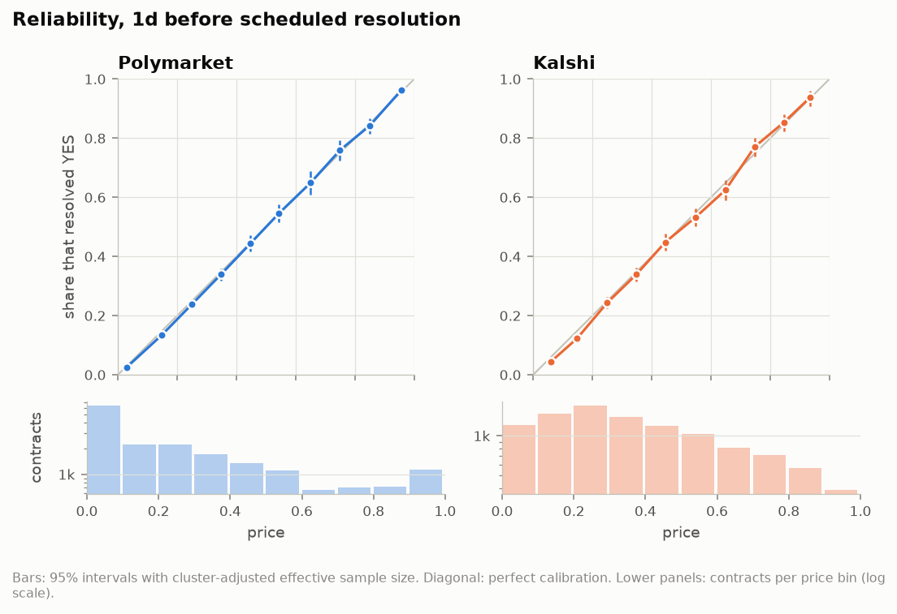
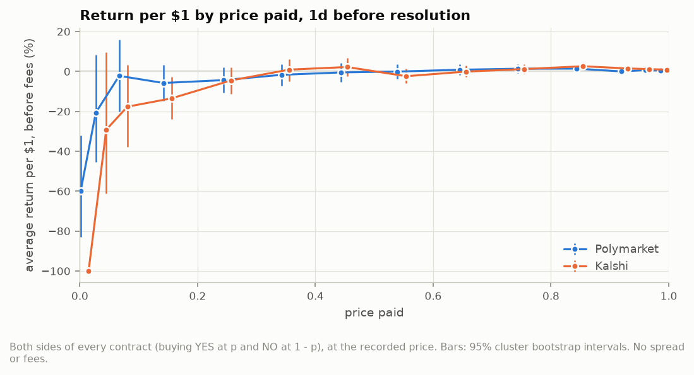
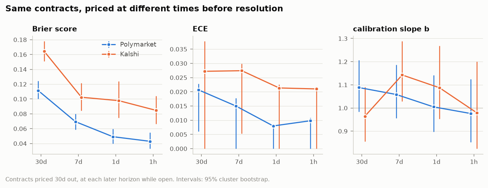
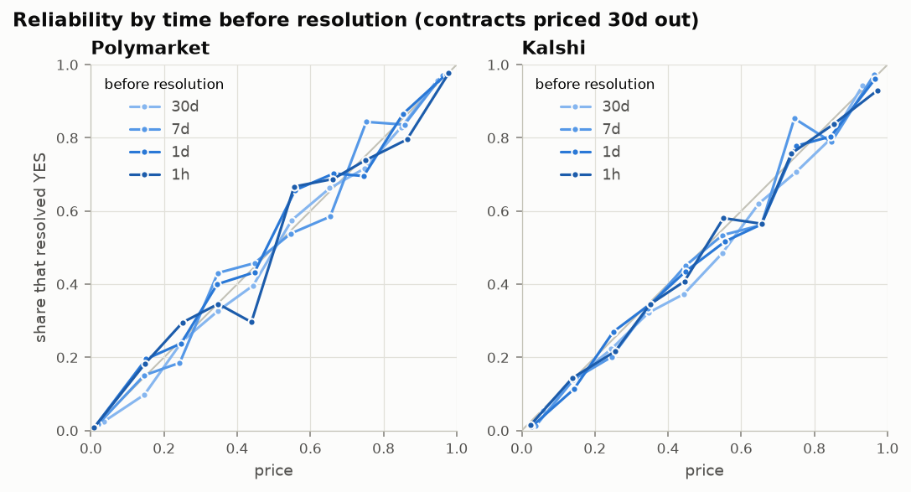
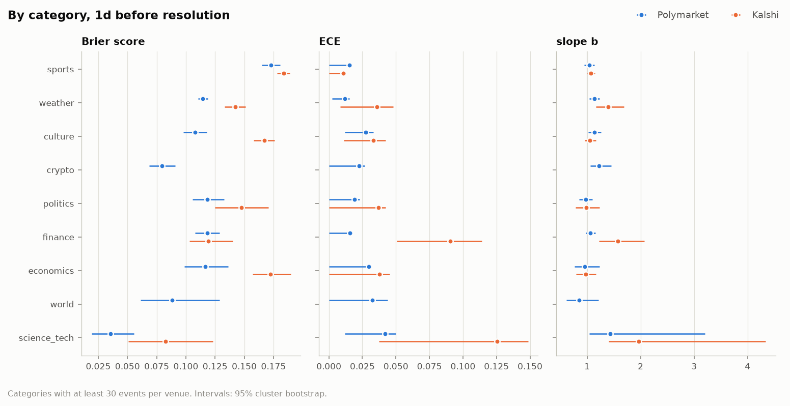
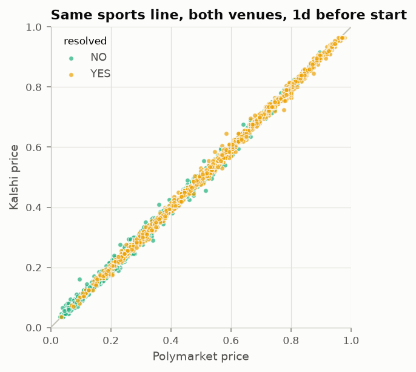
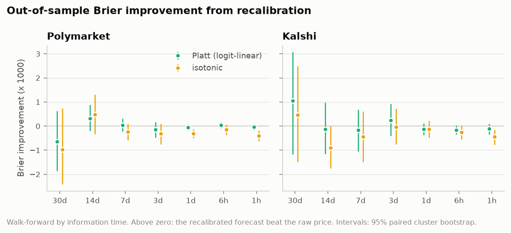
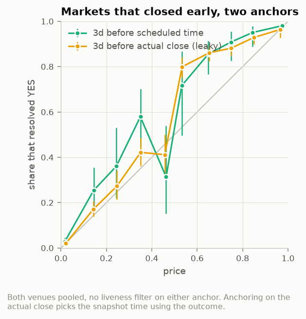

# pm-calibration report: main

## Data and selection

| venue | frame contracts | frame events | sampled contracts | sampled events |
| :--- | ---: | ---: | ---: | ---: |
| Polymarket | 1,331,687 | 193,923 | 118,305 | 20,036 |
| Kalshi | 1,949,423 | 347,234 | 54,289 | 13,404 |

Sampled events by category:

| category | kalshi | polymarket |
| :--- | ---: | ---: |
| crypto | 184 | 1,057 |
| culture | 1,803 | 2,186 |
| economics | 780 | 364 |
| finance | 785 | 3,824 |
| other | 2 | 19 |
| politics | 1,109 | 1,595 |
| science_tech | 244 | 323 |
| sports | 7,920 | 7,857 |
| weather | 564 | 1,747 |
| world | 13 | 1,065 |

Contracts surviving each rule (scheduled anchor):

| step | kalshi | polymarket |
| :--- | ---: | ---: |
| sampled contracts | 54,289 | 118,305 |
| sampled events | 13,404 | 20,036 |
| resolved | 54,004 | 118,083 |
| void | 0 | 0 |
| split | 285 | 202 |
| unresolved | 0 | 20 |
| early close (>1d before schedule) | 6,656 | 17,214 |
| 30d: open & priced | 8,828 | 16,916 |
| 30d: live (quote or trade) | 4,966 | 8,558 |
| 30d: confirmed quote | 2,774 | 3,214 |
| 14d: open & priced | 13,602 | 25,844 |
| 14d: live (quote or trade) | 6,957 | 11,612 |
| 14d: confirmed quote | 3,528 | 4,148 |
| 7d: open & priced | 15,865 | 44,420 |
| 7d: live (quote or trade) | 8,921 | 18,614 |
| 7d: confirmed quote | 4,358 | 8,006 |
| 3d: open & priced | 25,255 | 72,007 |
| 3d: live (quote or trade) | 16,447 | 36,990 |
| 3d: confirmed quote | 9,357 | 13,630 |
| 1d: open & priced | 34,128 | 94,166 |
| 1d: live (quote or trade) | 25,843 | 58,383 |
| 1d: confirmed quote | 15,752 | 21,435 |
| 6h: open & priced | 37,967 | 94,781 |
| 6h: live (quote or trade) | 32,227 | 67,680 |
| 6h: confirmed quote | 20,070 | 22,860 |
| 1h: open & priced | 38,119 | 91,473 |
| 1h: live (quote or trade) | 33,485 | 69,530 |
| 1h: confirmed quote | 20,638 | 21,865 |

Snapshot status by horizon, resolved contracts, scheduled anchor:

| venue | horizon | bad_price | closed | no_data | not_open | ok | too_old |
| :--- | ---: | ---: | ---: | ---: | ---: | ---: | ---: |
| kalshi | 14d | 1,150 | 2,905 | 70 | 36,119 | 13,602 | 158 |
| kalshi | 1d | 3,834 | 7,268 | 299 | 8,094 | 34,128 | 381 |
| kalshi | 1h | 2,552 | 13,014 | 74 | 0 | 38,119 | 245 |
| kalshi | 30d | 637 | 1,343 | 1,051 | 42,096 | 8,828 | 49 |
| kalshi | 3d | 3,658 | 5,446 | 234 | 19,157 | 25,255 | 254 |
| kalshi | 6h | 3,068 | 11,012 | 68 | 1,571 | 37,967 | 318 |
| kalshi | 7d | 2,502 | 4,434 | 514 | 30,501 | 15,865 | 188 |
| polymarket | 14d | 0 | 7,654 | 824 | 81,369 | 25,844 | 2,392 |
| polymarket | 1d | 0 | 17,193 | 175 | 6,414 | 94,166 | 135 |
| polymarket | 1h | 0 | 26,343 | 67 | 0 | 91,473 | 200 |
| polymarket | 30d | 0 | 3,929 | 737 | 95,278 | 16,916 | 1,223 |
| polymarket | 3d | 0 | 13,757 | 136 | 32,183 | 72,007 | 0 |
| polymarket | 6h | 0 | 21,757 | 135 | 1,241 | 94,781 | 169 |
| polymarket | 7d | 0 | 9,862 | 136 | 63,652 | 44,420 | 13 |

## 1. Calibration (1d before scheduled resolution unless stated)

| venue | horizon | contracts | clusters | base rate | mean price | Brier | reliability (debiased) | resolution | ECE plug-in | ECE bias-corr. | ECE if calibrated | log loss | slope b | intercept a |
| :--- | ---: | ---: | ---: | ---: | ---: | ---: | ---: | ---: | ---: | ---: | ---: | ---: | ---: | ---: |
| kalshi | 1d | 10,477 | 1,005 | 0.393 | 0.401 | 0.1708 [0.1668, 0.1750] | 0.0001 [-0.0002, 0.0003] | 0.0670 [0.0625, 0.0717] | 0.0133 | 0.0103 [0.0040, 0.0159] | 0.0099 | 0.5117 [0.5018, 0.5220] | 1.06 [1.01, 1.11] | -0.03 [-0.08, 0.03] |
| polymarket | 1d | 18,228 | 1,588 | 0.298 | 0.303 | 0.1213 [0.1175, 0.1252] | -0.0000 [-0.0002, 0.0001] | 0.0871 [0.0828, 0.0917] | 0.0067 | 0.0041 [0.0004, 0.0075] | 0.0065 | 0.3736 [0.3624, 0.3848] | 1.05 [1.01, 1.10] | -0.01 [-0.05, 0.03] |

Reliability (debiased) subtracts each bin's cluster-robust sampling variance, so it is about zero for calibrated prices and its interval is the one to read for 'is the miscalibration larger than noise'. The plug-in ECE is biased upwards; its bias-corrected value and basic interval are shown, but near zero that interval is too narrow (in simulation it covered a true ECE of 0 about half the time), so it is descriptive. 'ECE if calibrated' is the mean ECE of outcomes simulated as independent draws at the quoted prices.

All horizons (each horizon on its own set of contracts):

| venue | horizon | contracts | clusters | base rate | mean price | Brier | reliability (debiased) | resolution | ECE plug-in | ECE bias-corr. | ECE if calibrated | log loss | slope b | intercept a |
| :--- | ---: | ---: | ---: | ---: | ---: | ---: | ---: | ---: | ---: | ---: | ---: | ---: | ---: | ---: |
| kalshi | 30d | 2,702 | 429 | 0.369 | 0.395 | 0.1645 [0.1512, 0.1772] | 0.0005 [-0.0023, 0.0020] | 0.0689 [0.0585, 0.0820] | 0.0272 | 0.0210 [0.0000, 0.0380] | 0.0194 | 0.4972 [0.4636, 0.5295] | 0.96 [0.86, 1.08] | -0.17 [-0.34, -0.01] |
| kalshi | 14d | 3,354 | 572 | 0.375 | 0.392 | 0.1599 [0.1506, 0.1693] | 0.0000 [-0.0012, 0.0008] | 0.0738 [0.0658, 0.0833] | 0.0212 | 0.0163 [0.0035, 0.0277] | 0.0170 | 0.4841 [0.4606, 0.5072] | 1.06 [0.97, 1.17] | -0.08 [-0.20, 0.03] |
| kalshi | 7d | 3,785 | 638 | 0.396 | 0.416 | 0.1665 [0.1581, 0.1746] | 0.0002 [-0.0011, 0.0009] | 0.0727 [0.0656, 0.0806] | 0.0220 | 0.0175 [0.0058, 0.0281] | 0.0163 | 0.5010 [0.4801, 0.5217] | 1.02 [0.94, 1.10] | -0.12 [-0.20, -0.02] |
| kalshi | 3d | 6,529 | 811 | 0.391 | 0.411 | 0.1714 [0.1653, 0.1773] | 0.0004 [-0.0004, 0.0009] | 0.0663 [0.0602, 0.0729] | 0.0218 | 0.0193 [0.0094, 0.0282] | 0.0122 | 0.5142 [0.4992, 0.5291] | 1.01 [0.94, 1.08] | -0.11 [-0.18, -0.05] |
| kalshi | 1d | 10,477 | 1,005 | 0.393 | 0.401 | 0.1708 [0.1668, 0.1750] | 0.0001 [-0.0002, 0.0003] | 0.0670 [0.0625, 0.0717] | 0.0133 | 0.0103 [0.0040, 0.0159] | 0.0099 | 0.5117 [0.5018, 0.5220] | 1.06 [1.01, 1.11] | -0.03 [-0.08, 0.03] |
| kalshi | 6h | 13,014 | 873 | 0.405 | 0.410 | 0.1754 [0.1718, 0.1789] | -0.0000 [-0.0003, 0.0001] | 0.0648 [0.0611, 0.0688] | 0.0084 | 0.0044 [0.0000, 0.0092] | 0.0088 | 0.5234 [0.5148, 0.5324] | 1.03 [0.99, 1.07] | -0.02 [-0.07, 0.03] |
| kalshi | 1h | 13,475 | 783 | 0.403 | 0.409 | 0.1774 [0.1739, 0.1808] | -0.0000 [-0.0003, 0.0001] | 0.0624 [0.0592, 0.0662] | 0.0081 | 0.0041 [0.0000, 0.0094] | 0.0084 | 0.5285 [0.5200, 0.5369] | 1.02 [0.98, 1.06] | -0.03 [-0.08, 0.02] |
| polymarket | 30d | 3,197 | 356 | 0.272 | 0.289 | 0.1115 [0.1002, 0.1243] | 0.0001 [-0.0008, 0.0008] | 0.0868 [0.0765, 0.0976] | 0.0207 | 0.0152 [0.0066, 0.0233] | 0.0146 | 0.3535 [0.3226, 0.3897] | 1.09 [0.99, 1.20] | -0.09 [-0.23, 0.06] |
| polymarket | 14d | 4,113 | 506 | 0.263 | 0.266 | 0.1030 [0.0941, 0.1117] | 0.0003 [-0.0007, 0.0009] | 0.0905 [0.0816, 0.0996] | 0.0187 | 0.0165 [0.0075, 0.0250] | 0.0125 | 0.3299 [0.3046, 0.3541] | 1.11 [1.01, 1.21] | 0.03 [-0.07, 0.13] |
| polymarket | 7d | 7,632 | 905 | 0.294 | 0.299 | 0.1061 [0.0994, 0.1134] | 0.0001 [-0.0003, 0.0004] | 0.1006 [0.0936, 0.1073] | 0.0125 | 0.0094 [0.0032, 0.0154] | 0.0095 | 0.3359 [0.3170, 0.3563] | 1.07 [1.00, 1.13] | -0.01 [-0.08, 0.06] |
| polymarket | 3d | 12,156 | 1,342 | 0.314 | 0.322 | 0.1168 [0.1117, 0.1227] | 0.0000 [-0.0003, 0.0003] | 0.0978 [0.0923, 0.1032] | 0.0087 | 0.0051 [0.0000, 0.0102] | 0.0076 | 0.3650 [0.3504, 0.3812] | 1.02 [0.97, 1.07] | -0.05 [-0.12, 0.01] |
| polymarket | 1d | 18,228 | 1,588 | 0.298 | 0.303 | 0.1213 [0.1175, 0.1252] | -0.0000 [-0.0002, 0.0001] | 0.0871 [0.0828, 0.0917] | 0.0067 | 0.0041 [0.0004, 0.0075] | 0.0065 | 0.3736 [0.3624, 0.3848] | 1.05 [1.01, 1.10] | -0.01 [-0.05, 0.03] |
| polymarket | 6h | 17,495 | 1,538 | 0.338 | 0.344 | 0.1318 [0.1272, 0.1362] | 0.0000 [-0.0002, 0.0002] | 0.0913 [0.0874, 0.0954] | 0.0092 | 0.0072 [0.0027, 0.0110] | 0.0067 | 0.4023 [0.3896, 0.4146] | 1.03 [0.99, 1.08] | -0.03 [-0.07, 0.01] |
| polymarket | 1h | 15,823 | 1,401 | 0.342 | 0.348 | 0.1349 [0.1298, 0.1402] | -0.0000 [-0.0002, 0.0001] | 0.0894 [0.0850, 0.0938] | 0.0068 | 0.0039 [0.0000, 0.0076] | 0.0071 | 0.4076 [0.3933, 0.4223] | 1.03 [0.99, 1.08] | -0.03 [-0.07, 0.01] |

## 2. Favourite-longshot bias

Slope b and intercept a from logit P(YES) = a + b logit(price), fitted on the contracts as listed. b > 1: prices too close to 0.5 (cheap contracts overpriced, expensive ones underpriced, around the point where the fitted curve crosses the diagonal); a < 0: the listed (YES) side overpriced at all prices. Fitting a and b together is what separates the two. The symmetrised slope (every contract and its complement) forces a = 0, and with listed prices skewed towards cheap YES contracts it absorbs a YES lean as an apparent longshot bias, so it is shown only for comparison.

| venue | horizon | contracts | slope b | slope cluster-robust se | intercept a | symmetrised slope (a forced to 0) |
| :--- | ---: | ---: | ---: | ---: | ---: | ---: |
| kalshi | 30d | 2,702 | 0.964 [0.861, 1.083] | 0.059 | -0.170 [-0.340, -0.011] | 0.998 [0.895, 1.116] |
| kalshi | 14d | 3,354 | 1.063 [0.972, 1.165] | 0.048 | -0.085 [-0.201, 0.034] | 1.082 [0.997, 1.175] |
| kalshi | 7d | 3,785 | 1.019 [0.942, 1.103] | 0.042 | -0.116 [-0.204, -0.023] | 1.039 [0.965, 1.118] |
| kalshi | 3d | 6,529 | 1.013 [0.945, 1.083] | 0.035 | -0.115 [-0.183, -0.045] | 1.038 [0.974, 1.104] |
| kalshi | 1d | 10,477 | 1.065 [1.014, 1.114] | 0.026 | -0.029 [-0.084, 0.026] | 1.073 [1.025, 1.118] |
| kalshi | 6h | 13,014 | 1.033 [0.992, 1.074] | 0.021 | -0.017 [-0.069, 0.031] | 1.037 [0.999, 1.075] |
| kalshi | 1h | 13,475 | 1.023 [0.984, 1.064] | 0.021 | -0.025 [-0.075, 0.019] | 1.029 [0.991, 1.068] |
| polymarket | 30d | 3,197 | 1.088 [0.985, 1.200] | 0.058 | -0.090 [-0.227, 0.055] | 1.113 [1.027, 1.204] |
| polymarket | 14d | 4,113 | 1.105 [1.010, 1.210] | 0.049 | 0.033 [-0.067, 0.133] | 1.095 [1.009, 1.188] |
| polymarket | 7d | 7,632 | 1.067 [0.999, 1.134] | 0.035 | -0.011 [-0.082, 0.057] | 1.069 [1.007, 1.131] |
| polymarket | 3d | 12,156 | 1.021 [0.969, 1.072] | 0.026 | -0.055 [-0.116, 0.007] | 1.033 [0.985, 1.081] |
| polymarket | 1d | 18,228 | 1.052 [1.008, 1.099] | 0.023 | -0.012 [-0.053, 0.031] | 1.056 [1.016, 1.094] |
| polymarket | 6h | 17,495 | 1.031 [0.987, 1.076] | 0.022 | -0.032 [-0.069, 0.007] | 1.039 [0.998, 1.080] |
| polymarket | 1h | 15,823 | 1.035 [0.991, 1.079] | 0.023 | -0.032 [-0.070, 0.008] | 1.042 [0.999, 1.083] |

By how the price was formed, 1d out. 'quote': a tight two-sided market (the main analysis). 'last trade': no tight quote, priced at a trade in the previous 24h.

| venue | price_rule | contracts | clusters | base rate | mean price | Brier | reliability (debiased) | resolution | ECE plug-in | ECE bias-corr. | ECE if calibrated | log loss | slope b | intercept a |
| :--- | ---: | ---: | ---: | ---: | ---: | ---: | ---: | ---: | ---: | ---: | ---: | ---: | ---: | ---: |
| kalshi | last trade | 9,252 | 1,098 | 0.259 | 0.290 | 0.0676 [0.0612, 0.0740] | 0.0018 [0.0009, 0.0027] | 0.1257 [0.1167, 0.1339] | 0.0311 | 0.0309 [0.0252, 0.0362] | 0.0068 | 0.2258 [0.2063, 0.2454] | 0.99 [0.94, 1.05] | -0.47 [-0.56, -0.38] |
| kalshi | quote | 10,477 | 1,005 | 0.393 | 0.401 | 0.1708 [0.1668, 0.1750] | 0.0001 [-0.0002, 0.0003] | 0.0670 [0.0625, 0.0717] | 0.0133 | 0.0103 [0.0040, 0.0159] | 0.0099 | 0.5117 [0.5018, 0.5220] | 1.06 [1.01, 1.11] | -0.03 [-0.08, 0.03] |
| polymarket | last trade | 36,410 | 1,632 | 0.154 | 0.161 | 0.0408 [0.0381, 0.0434] | 0.0003 [0.0001, 0.0005] | 0.0897 [0.0839, 0.0956] | 0.0076 | 0.0072 [0.0051, 0.0094] | 0.0025 | 0.1386 [0.1300, 0.1467] | 0.95 [0.92, 0.98] | -0.21 [-0.28, -0.15] |
| polymarket | quote | 18,228 | 1,588 | 0.298 | 0.303 | 0.1213 [0.1174, 0.1250] | -0.0000 [-0.0002, 0.0001] | 0.0871 [0.0827, 0.0914] | 0.0067 | 0.0041 [0.0002, 0.0077] | 0.0064 | 0.3736 [0.3629, 0.3846] | 1.05 [1.01, 1.10] | -0.01 [-0.05, 0.03] |

Polymarket, 1d out: total payout over total cost of buying one contract of each, at the recorded price (the mid, or the last trade when the book is wide), before spread and fees. Each bin mirrors the bin at 1 - price (the same contracts bought on the other side), so the two halves of the table are not independent evidence.

| price bin | contracts | clusters | mean price | return per $1 at the price |
| :--- | ---: | ---: | ---: | ---: |
| 0.00-0.02 | 3,716 | 883 | 0.007 | -60.0% [-83.0, -32.0] |
| 0.02-0.05 | 1,754 | 764 | 0.033 | -20.7% [-45.4, +8.4] |
| 0.05-0.10 | 2,022 | 815 | 0.073 | -2.2% [-20.2, +16.0] |
| 0.10-0.20 | 2,959 | 958 | 0.148 | -5.8% [-14.6, +3.3] |
| 0.20-0.30 | 2,943 | 913 | 0.250 | -4.3% [-10.5, +1.9] |
| 0.30-0.40 | 2,376 | 868 | 0.348 | -1.7% [-7.1, +3.7] |
| 0.40-0.50 | 2,368 | 881 | 0.450 | -0.5% [-5.4, +4.3] |
| 0.50-0.60 | 2,476 | 896 | 0.545 | -0.1% [-3.6, +3.7] |
| 0.60-0.70 | 2,517 | 884 | 0.651 | +0.9% [-1.8, +3.7] |
| 0.70-0.80 | 2,793 | 902 | 0.750 | +1.4% [-0.8, +3.5] |
| 0.80-0.90 | 2,979 | 962 | 0.850 | +1.4% [-0.2, +2.9] |
| 0.90-0.95 | 2,006 | 810 | 0.925 | +0.0% [-1.5, +1.4] |
| 0.95-0.98 | 1,792 | 780 | 0.966 | +0.7% [-0.3, +1.5] |
| 0.98-1.00 | 3,755 | 887 | 0.992 | +0.4% [+0.2, +0.6] |

Kalshi, 1d out: total payout over total cost of buying one contract of each, at the recorded price (the mid, or the last trade when the book is wide), before spread and fees. Each bin mirrors the bin at 1 - price (the same contracts bought on the other side), so the two halves of the table are not independent evidence.

| price bin | contracts | clusters | mean price | return per $1 at the price |
| :--- | ---: | ---: | ---: | ---: |
| 0.00-0.02 | 53 | 24 | 0.009 | -100.0% [-100.0, -100.0] |
| 0.02-0.05 | 509 | 316 | 0.039 | -29.2% [-61.1, +9.5] |
| 0.05-0.10 | 1,041 | 480 | 0.075 | -17.6% [-37.8, +3.4] |
| 0.10-0.20 | 2,032 | 657 | 0.150 | -13.5% [-23.9, -2.8] |
| 0.20-0.30 | 2,408 | 672 | 0.250 | -4.5% [-11.4, +2.1] |
| 0.30-0.40 | 2,217 | 669 | 0.349 | +0.9% [-4.8, +6.0] |
| 0.40-0.50 | 2,175 | 646 | 0.448 | +2.2% [-2.4, +6.7] |
| 0.50-0.60 | 2,173 | 644 | 0.548 | -2.4% [-6.0, +1.5] |
| 0.60-0.70 | 2,329 | 680 | 0.650 | -0.1% [-2.7, +2.9] |
| 0.70-0.80 | 2,327 | 665 | 0.749 | +1.2% [-1.2, +3.6] |
| 0.80-0.90 | 2,054 | 660 | 0.848 | +2.6% [+0.7, +4.5] |
| 0.90-0.95 | 1,074 | 490 | 0.925 | +1.5% [-0.2, +3.1] |
| 0.95-0.98 | 509 | 316 | 0.961 | +1.2% [-0.4, +2.5] |
| 0.98-1.00 | 53 | 24 | 0.991 | +0.9% [+0.8, +1.0] |

## 3. Calibration and time to resolution

Contracts with a confirmed quote 30d before scheduled resolution, scored again at 7d, 1d, 1h with any live price (a confirmed quote or a trade in the previous 24h) while they were still open. The population is fixed by what was known 30d out and shrinks only by what was known at each later horizon. (Requiring a live price at every horizon would keep only markets that did not resolve early, which for 'by date' markets selects on the outcome and makes the long-horizon prices look worse than they were.) Differences are against the longest horizon, with paired cluster intervals.

| venue | horizon | metric | contracts | clusters | value | diff |
| :--- | ---: | ---: | ---: | ---: | ---: | ---: |
| polymarket | 30d | brier | 3,197 | 356 | 0.1115 [0.1003, 0.1244] |  |
| polymarket | 30d | ece | 3,197 | 356 | 0.0207 [0.0060, 0.0228] |  |
| polymarket | 30d | log_loss | 3,197 | 356 | 0.3535 [0.3224, 0.3885] |  |
| polymarket | 30d | slope | 3,197 | 356 | 1.0882 [0.9834, 1.2063] |  |
| polymarket | 30d | intercept | 3,197 | 356 | -0.0902 [-0.2305, 0.0508] |  |
| polymarket | 7d | brier | 2,052 | 309 | 0.0694 [0.0587, 0.0798] | -0.0421 [-0.0511, -0.0317] |
| polymarket | 7d | ece | 2,052 | 309 | 0.0150 [0.0000, 0.0178] | -0.0057 [-0.0187, +0.0060] |
| polymarket | 7d | log_loss | 2,052 | 309 | 0.2272 [0.1957, 0.2576] | -0.1263 [-0.1509, -0.0985] |
| polymarket | 7d | slope | 2,052 | 309 | 1.0583 [0.9564, 1.1867] | -0.0300 [-0.1477, +0.0887] |
| polymarket | 7d | intercept | 2,052 | 309 | 0.0330 [-0.1242, 0.1875] | +0.1232 [-0.0711, +0.3278] |
| polymarket | 1d | brier | 1,943 | 297 | 0.0492 [0.0398, 0.0599] | -0.0623 [-0.0751, -0.0484] |
| polymarket | 1d | ece | 1,943 | 297 | 0.0080 [0.0000, 0.0074] | -0.0127 [-0.0264, -0.0030] |
| polymarket | 1d | log_loss | 1,943 | 297 | 0.1623 [0.1343, 0.1955] | -0.1912 [-0.2299, -0.1506] |
| polymarket | 1d | slope | 1,943 | 297 | 1.0048 [0.8969, 1.1411] | -0.0835 [-0.2242, +0.0681] |
| polymarket | 1d | intercept | 1,943 | 297 | 0.0939 [-0.0785, 0.2618] | +0.1841 [-0.0227, +0.4131] |
| polymarket | 1h | brier | 1,751 | 282 | 0.0429 [0.0330, 0.0547] | -0.0686 [-0.0837, -0.0538] |
| polymarket | 1h | ece | 1,751 | 282 | 0.0098 [0.0000, 0.0108] | -0.0109 [-0.0235, +0.0011] |
| polymarket | 1h | log_loss | 1,751 | 282 | 0.1412 [0.1110, 0.1767] | -0.2123 [-0.2560, -0.1681] |
| polymarket | 1h | slope | 1,751 | 282 | 0.9759 [0.8529, 1.1238] | -0.1123 [-0.2662, +0.0575] |
| polymarket | 1h | intercept | 1,751 | 282 | -0.0133 [-0.1903, 0.1638] | +0.0769 [-0.1353, +0.2845] |
| kalshi | 30d | brier | 2,702 | 429 | 0.1645 [0.1509, 0.1779] |  |
| kalshi | 30d | ece | 2,702 | 429 | 0.0272 [0.0000, 0.0378] |  |
| kalshi | 30d | log_loss | 2,702 | 429 | 0.4972 [0.4627, 0.5314] |  |
| kalshi | 30d | slope | 2,702 | 429 | 0.9644 [0.8554, 1.0901] |  |
| kalshi | 30d | intercept | 2,702 | 429 | -0.1699 [-0.3329, -0.0117] |  |
| kalshi | 7d | brier | 1,606 | 339 | 0.1023 [0.0845, 0.1215] | -0.0621 [-0.0816, -0.0427] |
| kalshi | 7d | ece | 1,606 | 339 | 0.0274 [0.0053, 0.0299] | +0.0002 [-0.0209, +0.0205] |
| kalshi | 7d | log_loss | 1,606 | 339 | 0.3225 [0.2740, 0.3721] | -0.1747 [-0.2266, -0.1243] |
| kalshi | 7d | slope | 1,606 | 339 | 1.1425 [1.0286, 1.2882] | +0.1781 [+0.0255, +0.3428] |
| kalshi | 7d | intercept | 1,606 | 339 | -0.0877 [-0.2509, 0.0930] | +0.0822 [-0.0897, +0.2703] |
| kalshi | 1d | brier | 1,233 | 277 | 0.0978 [0.0747, 0.1241] | -0.0667 [-0.0908, -0.0415] |
| kalshi | 1d | ece | 1,233 | 277 | 0.0213 [0.0000, 0.0226] | -0.0059 [-0.0291, +0.0170] |
| kalshi | 1d | log_loss | 1,233 | 277 | 0.3021 [0.2405, 0.3737] | -0.1950 [-0.2606, -0.1258] |
| kalshi | 1d | slope | 1,233 | 277 | 1.0872 [0.9529, 1.2679] | +0.1228 [-0.0366, +0.3026] |
| kalshi | 1d | intercept | 1,233 | 277 | -0.1358 [-0.3264, 0.1053] | +0.0342 [-0.1554, +0.2909] |
| kalshi | 1h | brier | 748 | 217 | 0.0846 [0.0662, 0.1043] | -0.0798 [-0.1004, -0.0566] |
| kalshi | 1h | ece | 748 | 217 | 0.0210 [0.0000, 0.0209] | -0.0062 [-0.0373, +0.0089] |
| kalshi | 1h | log_loss | 748 | 217 | 0.2706 [0.2165, 0.3290] | -0.2265 [-0.2859, -0.1607] |
| kalshi | 1h | slope | 748 | 217 | 0.9790 [0.8245, 1.1997] | +0.0145 [-0.1634, +0.2381] |
| kalshi | 1h | intercept | 748 | 217 | -0.1992 [-0.4700, 0.0889] | -0.0293 [-0.2756, +0.2559] |

## 4. Category, liquidity and venue (1d)

| venue | category | contracts | clusters | base rate | mean price | Brier | reliability (debiased) | resolution | ECE plug-in | ECE bias-corr. | ECE if calibrated | log loss | slope b | intercept a |
| :--- | ---: | ---: | ---: | ---: | ---: | ---: | ---: | ---: | ---: | ---: | ---: | ---: | ---: | ---: |
| kalshi | culture | 2,365 | 207 | 0.456 | 0.484 | 0.1673 [0.1581, 0.1761] | 0.0009 [-0.0012, 0.0023] | 0.0823 [0.0731, 0.0926] | 0.0330 | 0.0283 [0.0113, 0.0422] | 0.0210 | 0.5053 [0.4828, 0.5270] | 1.06 [0.96, 1.17] | -0.17 [-0.29, -0.06] |
| kalshi | economics | 908 | 135 | 0.453 | 0.466 | 0.1724 [0.1570, 0.1898] | 0.0000 [-0.0049, 0.0027] | 0.0773 [0.0628, 0.0945] | 0.0375 | 0.0240 [0.0000, 0.0455] | 0.0339 | 0.5173 [0.4783, 0.5624] | 0.97 [0.80, 1.16] | -0.08 [-0.32, 0.16] |
| kalshi | finance | 366 | 75 | 0.440 | 0.459 | 0.1193 [0.1029, 0.1401] | 0.0064 [-0.0037, 0.0146] | 0.1377 [0.1134, 0.1634] | 0.0904 | 0.0836 [0.0508, 0.1142] | 0.0502 | 0.3890 [0.3466, 0.4423] | 1.58 [1.22, 2.07] | -0.08 [-0.52, 0.34] |
| kalshi | politics | 500 | 117 | 0.388 | 0.383 | 0.1476 [0.1249, 0.1707] | -0.0012 [-0.0091, 0.0028] | 0.0903 [0.0722, 0.1169] | 0.0368 | 0.0194 [0.0000, 0.0421] | 0.0418 | 0.4486 [0.3894, 0.5092] | 0.98 [0.78, 1.24] | 0.03 [-0.20, 0.27] |
| kalshi | science_tech | 66 | 34 | 0.500 | 0.517 | 0.0827 [0.0508, 0.1230] | 0.0076 [-0.0352, 0.0325] | 0.1949 [0.1585, 0.2371] | 0.1255 | 0.1042 [0.0374, 0.1486] | 0.1112 | 0.2820 [0.1998, 0.3811] | 1.97 [1.40, 4.34] | -0.26 [-1.59, 1.11] |
| kalshi | sports | 5,350 | 261 | 0.377 | 0.377 | 0.1835 [0.1780, 0.1889] | -0.0001 [-0.0006, 0.0002] | 0.0503 [0.0456, 0.0559] | 0.0107 | 0.0044 [0.0000, 0.0118] | 0.0133 | 0.5427 [0.5289, 0.5560] | 1.07 [1.00, 1.15] | 0.03 [-0.05, 0.10] |
| kalshi | weather | 900 | 167 | 0.240 | 0.248 | 0.1423 [0.1334, 0.1511] | 0.0001 [-0.0031, 0.0020] | 0.0386 [0.0301, 0.0509] | 0.0357 | 0.0301 [0.0085, 0.0480] | 0.0281 | 0.4365 [0.4143, 0.4592] | 1.39 [1.17, 1.69] | 0.27 [0.07, 0.50] |
| polymarket | crypto | 968 | 203 | 0.300 | 0.290 | 0.0797 [0.0688, 0.0910] | -0.0005 [-0.0035, 0.0015] | 0.1307 [0.1178, 0.1471] | 0.0224 | 0.0141 [0.0000, 0.0269] | 0.0223 | 0.2417 [0.2096, 0.2732] | 1.23 [1.06, 1.45] | 0.20 [-0.03, 0.44] |
| polymarket | culture | 2,530 | 234 | 0.341 | 0.360 | 0.1081 [0.0980, 0.1179] | 0.0007 [-0.0009, 0.0018] | 0.1170 [0.1065, 0.1283] | 0.0276 | 0.0232 [0.0120, 0.0332] | 0.0166 | 0.3382 [0.3112, 0.3652] | 1.14 [1.03, 1.26] | -0.14 [-0.29, -0.01] |
| polymarket | economics | 560 | 104 | 0.304 | 0.299 | 0.1164 [0.0988, 0.1361] | 0.0003 [-0.0056, 0.0043] | 0.0975 [0.0812, 0.1202] | 0.0299 | 0.0132 [0.0000, 0.0316] | 0.0329 | 0.3630 [0.3138, 0.4179] | 0.95 [0.77, 1.23] | 0.01 [-0.19, 0.25] |
| polymarket | finance | 2,278 | 182 | 0.409 | 0.414 | 0.1183 [0.1077, 0.1288] | -0.0001 [-0.0017, 0.0010] | 0.1227 [0.1136, 0.1335] | 0.0158 | 0.0071 [0.0000, 0.0176] | 0.0186 | 0.3653 [0.3364, 0.3959] | 1.06 [0.97, 1.15] | -0.04 [-0.19, 0.12] |
| polymarket | politics | 1,762 | 159 | 0.330 | 0.338 | 0.1184 [0.1056, 0.1329] | 0.0001 [-0.0024, 0.0015] | 0.1029 [0.0907, 0.1180] | 0.0190 | 0.0101 [0.0000, 0.0230] | 0.0205 | 0.3704 [0.3329, 0.4117] | 0.97 [0.85, 1.10] | -0.08 [-0.18, 0.03] |
| polymarket | science_tech | 216 | 55 | 0.347 | 0.326 | 0.0353 [0.0192, 0.0554] | 0.0023 [-0.0089, 0.0108] | 0.1987 [0.1833, 0.2201] | 0.0419 | 0.0337 [0.0118, 0.0500] | 0.0366 | 0.1324 [0.0838, 0.1975] | 1.44 [1.04, 3.20] | 0.81 [0.23, 2.86] |
| polymarket | sports | 3,335 | 264 | 0.393 | 0.397 | 0.1730 [0.1650, 0.1808] | -0.0001 [-0.0010, 0.0004] | 0.0651 [0.0582, 0.0729] | 0.0152 | 0.0078 [0.0000, 0.0173] | 0.0169 | 0.5132 [0.4936, 0.5326] | 1.04 [0.95, 1.14] | -0.01 [-0.08, 0.06] |
| polymarket | weather | 5,744 | 252 | 0.183 | 0.187 | 0.1145 [0.1105, 0.1186] | -0.0000 [-0.0005, 0.0004] | 0.0343 [0.0308, 0.0384] | 0.0118 | 0.0093 [0.0025, 0.0154] | 0.0094 | 0.3551 [0.3440, 0.3666] | 1.13 [1.04, 1.23] | 0.09 [-0.00, 0.20] |
| polymarket | world | 829 | 131 | 0.199 | 0.190 | 0.0884 [0.0611, 0.1289] | -0.0007 [-0.0059, 0.0021] | 0.0711 [0.0513, 0.0961] | 0.0323 | 0.0222 [0.0000, 0.0436] | 0.0231 | 0.2991 [0.2109, 0.4291] | 0.85 [0.61, 1.22] | -0.04 [-0.38, 0.36] |

Slope b and intercept a are fitted together on the contracts as listed. With this many categories, horizons and venues some intervals will exclude the reference value by chance (about 1 in 20 when nothing differs).

Trading in the 24h before the snapshot (known at the time). busy: at least 50 trades (Polymarket) or 1,000 contracts traded (Kalshi, which reports no trade count), so 'busy' is not the same bar on the two venues; traded: at least one trade; no trade: price confirmed only by a two-sided quote within 10c (Kalshi only; Polymarket requires a trade).

| venue | activity | contracts | clusters | base rate | mean price | Brier | reliability (debiased) | resolution | ECE plug-in | ECE bias-corr. | ECE if calibrated | log loss | slope b | intercept a |
| :--- | ---: | ---: | ---: | ---: | ---: | ---: | ---: | ---: | ---: | ---: | ---: | ---: | ---: | ---: |
| kalshi | busy | 2,764 | 714 | 0.364 | 0.374 | 0.1583 [0.1497, 0.1671] | 0.0002 [-0.0011, 0.0011] | 0.0731 [0.0648, 0.0824] | 0.0237 | 0.0174 [0.0053, 0.0289] | 0.0186 | 0.4784 [0.4575, 0.5013] | 1.08 [0.97, 1.19] | -0.03 [-0.13, 0.07] |
| kalshi | no trade | 2,675 | 401 | 0.394 | 0.399 | 0.1828 [0.1745, 0.1909] | 0.0002 [-0.0011, 0.0010] | 0.0554 [0.0486, 0.0639] | 0.0240 | 0.0183 [0.0051, 0.0299] | 0.0197 | 0.5429 [0.5227, 0.5627] | 1.07 [0.97, 1.18] | -0.00 [-0.12, 0.12] |
| kalshi | traded | 5,038 | 824 | 0.408 | 0.418 | 0.1713 [0.1660, 0.1766] | -0.0001 [-0.0006, 0.0003] | 0.0698 [0.0644, 0.0760] | 0.0126 | 0.0059 [0.0000, 0.0130] | 0.0144 | 0.5133 [0.5002, 0.5263] | 1.06 [0.99, 1.13] | -0.04 [-0.11, 0.03] |
| polymarket | busy | 5,326 | 980 | 0.296 | 0.297 | 0.1312 [0.1248, 0.1382] | 0.0002 [-0.0005, 0.0007] | 0.0768 [0.0696, 0.0842] | 0.0152 | 0.0114 [0.0030, 0.0185] | 0.0118 | 0.4058 [0.3876, 0.4256] | 1.03 [0.95, 1.12] | 0.02 [-0.06, 0.09] |
| polymarket | traded | 12,902 | 1,460 | 0.299 | 0.306 | 0.1172 [0.1130, 0.1218] | 0.0000 [-0.0002, 0.0002] | 0.0916 [0.0867, 0.0964] | 0.0103 | 0.0085 [0.0042, 0.0126] | 0.0074 | 0.3603 [0.3484, 0.3728] | 1.06 [1.02, 1.11] | -0.03 [-0.08, 0.02] |

Lifetime volume. This includes trading after the snapshot, so it is descriptive only: markets where something surprising happened attract volume, so high-volume buckets over-represent upsets (b pushed below 1) and low-volume buckets under-represent them. Kalshi's dollar volume is contracts times the YES-side average trade price, which a YES winner's late trades near $1 inflate, so its buckets also sort on the outcome directly.

| venue | volume bucket | contracts | clusters | base rate | mean price | Brier | reliability (debiased) | resolution | ECE plug-in | ECE bias-corr. | ECE if calibrated | log loss | slope b | intercept a |
| :--- | ---: | ---: | ---: | ---: | ---: | ---: | ---: | ---: | ---: | ---: | ---: | ---: | ---: | ---: |
| kalshi | $100k-$1M | 689 | 273 | 0.615 | 0.475 | 0.2359 [0.2189, 0.2537] | 0.0259 [0.0121, 0.0371] | 0.0283 [0.0195, 0.0425] | 0.1404 | 0.1360 [0.1033, 0.1666] | 0.0390 | 0.6650 [0.6238, 0.7076] | 0.67 [0.50, 0.85] | 0.61 [0.45, 0.79] |
| kalshi | $10k-$100k | 2,563 | 588 | 0.531 | 0.460 | 0.2188 [0.2087, 0.2288] | 0.0082 [0.0032, 0.0122] | 0.0388 [0.0318, 0.0472] | 0.0764 | 0.0710 [0.0512, 0.0892] | 0.0199 | 0.6272 [0.6027, 0.6518] | 0.73 [0.64, 0.83] | 0.29 [0.18, 0.40] |
| kalshi | $1M+ | 145 | 84 | 0.662 | 0.511 | 0.2367 [0.1974, 0.2714] | 0.0229 [-0.0095, 0.0477] | 0.0196 [0.0119, 0.0596] | 0.1509 | 0.1356 [0.0831, 0.1886] | 0.0836 | 0.6678 [0.5787, 0.7487] | 0.60 [0.27, 1.16] | 0.70 [0.46, 0.96] |
| kalshi | $1k-$10k | 4,289 | 820 | 0.417 | 0.425 | 0.1725 [0.1661, 0.1787] | 0.0001 [-0.0008, 0.0007] | 0.0705 [0.0647, 0.0778] | 0.0190 | 0.0139 [0.0030, 0.0241] | 0.0158 | 0.5179 [0.5019, 0.5333] | 1.08 [1.01, 1.16] | -0.03 [-0.11, 0.05] |
| polymarket | $100k-$1M | 2,050 | 639 | 0.360 | 0.340 | 0.1349 [0.1234, 0.1473] | 0.0001 [-0.0015, 0.0012] | 0.0959 [0.0863, 0.1078] | 0.0270 | 0.0218 [0.0075, 0.0334] | 0.0194 | 0.4097 [0.3779, 0.4456] | 0.92 [0.81, 1.02] | 0.12 [0.01, 0.24] |
| polymarket | $10k-$100k | 6,436 | 1,203 | 0.350 | 0.334 | 0.1452 [0.1394, 0.1517] | 0.0005 [-0.0001, 0.0011] | 0.0821 [0.0765, 0.0885] | 0.0230 | 0.0215 [0.0137, 0.0288] | 0.0111 | 0.4369 [0.4209, 0.4543] | 0.95 [0.89, 1.00] | 0.08 [0.02, 0.15] |
| polymarket | $1M+ | 462 | 201 | 0.346 | 0.310 | 0.1397 [0.1086, 0.1756] | 0.0023 [-0.0070, 0.0085] | 0.0891 [0.0661, 0.1161] | 0.0684 | 0.0554 [0.0167, 0.0904] | 0.0379 | 0.4404 [0.3428, 0.5580] | 0.71 [0.54, 0.96] | 0.14 [-0.10, 0.38] |
| polymarket | $1k-$10k | 7,477 | 1,140 | 0.250 | 0.276 | 0.1053 [0.1005, 0.1100] | 0.0011 [0.0005, 0.0016] | 0.0824 [0.0757, 0.0895] | 0.0307 | 0.0296 [0.0234, 0.0358] | 0.0098 | 0.3323 [0.3195, 0.3446] | 1.20 [1.13, 1.27] | -0.12 [-0.19, -0.04] |

### Same event on both venues

Pairs of contracts on the same proposition, priced at the same moment on both venues, with a confirmed quote on both. Kalshi minus Polymarket Brier differences with paired intervals, clustered on the real-world event.

| group | horizon | pairs | clusters | Brier Polymarket | Brier Kalshi | Kalshi - Polymarket | median |gap| | gap >= 5c | Polymarket closer when gap >= 5c |
| :--- | ---: | ---: | ---: | ---: | ---: | ---: | ---: | ---: | ---: |
| other families | 14d | 43 | 31 | 0.1392 [0.0827, 0.2021] | 0.1357 [0.0814, 0.1954] | -0.0035 [-0.0112, +0.0055] | 0.020 | 9.3% | 25% of 4 |
| other families | 1d | 185 | 102 | 0.1147 [0.0844, 0.1489] | 0.1130 [0.0839, 0.1459] | -0.0017 [-0.0044, +0.0008] | 0.010 | 3.2% | 33% of 6 |
| other families | 1h | 184 | 98 | 0.1079 [0.0813, 0.1408] | 0.1085 [0.0819, 0.1418] | +0.0006 [-0.0009, +0.0022] | 0.010 | 1.1% | 0% of 2 |
| other families | 30d | 36 | 23 | 0.1953 [0.1129, 0.2872] | 0.1931 [0.1116, 0.2843] | -0.0022 [-0.0119, +0.0085] | 0.016 | 11.1% | 50% of 4 |
| other families | 3d | 115 | 73 | 0.1198 [0.0820, 0.1641] | 0.1192 [0.0821, 0.1645] | -0.0006 [-0.0055, +0.0039] | 0.015 | 7.0% | 50% of 8 |
| other families | 6h | 198 | 108 | 0.1067 [0.0799, 0.1363] | 0.1078 [0.0803, 0.1364] | +0.0011 [-0.0027, +0.0060] | 0.010 | 4.0% | 62% of 8 |
| other families | 7d | 102 | 60 | 0.1154 [0.0830, 0.1489] | 0.1180 [0.0851, 0.1516] | +0.0026 [-0.0001, +0.0053] | 0.011 | 1.0% | 100% of 1 |
| sports lines | 1d | 2,840 | 998 | 0.1935 [0.1868, 0.2007] | 0.1937 [0.1869, 0.2009] | +0.0002 [-0.0001, +0.0005] | 0.005 | 0.2% | 60% of 5 |
| sports lines | 1h | 5,902 | 1,535 | 0.1863 [0.1818, 0.1909] | 0.1862 [0.1818, 0.1908] | -0.0000 [-0.0003, +0.0002] | 0.005 | 0.1% | 33% of 6 |
| sports lines | 3d | 1,181 | 496 | 0.2036 [0.1937, 0.2131] | 0.2042 [0.1943, 0.2138] | +0.0006 [+0.0001, +0.0011] | 0.005 | 0.3% | 50% of 4 |
| sports lines | 6h | 5,163 | 1,432 | 0.1882 [0.1834, 0.1932] | 0.1882 [0.1835, 0.1933] | +0.0001 [-0.0002, +0.0003] | 0.005 | 0.2% | 60% of 10 |
| sports lines | 7d | 213 | 91 | 0.2140 [0.1901, 0.2398] | 0.2131 [0.1896, 0.2392] | -0.0009 [-0.0029, +0.0010] | 0.005 | 0.9% | 0% of 2 |

Pairs with confirmed quotes on both venues, by family, at 1d:

| family | pairs | clusters |
| :--- | ---: | ---: |
| sports_moneyline | 1,902 | 980 |
| sports_total | 655 | 275 |
| sports_spread | 283 | 188 |
| awards | 91 | 52 |
| golf_top_n | 29 | 12 |
| election | 29 | 14 |
| golf_winner | 22 | 13 |
| cpi | 8 | 7 |
| fed_decision | 4 | 2 |
| unemployment | 2 | 2 |

## 5. Out-of-sample recalibration

Walk-forward, refitted every 7 days on contracts already resolved at the refit time, applied only to snapshots taken after it. Fitted separately per venue and horizon. Gain = raw score minus recalibrated score (positive means recalibration helped), with paired cluster intervals.

| venue | horizon | method | score | n_test | events_test | raw | recalibrated | gain | rel |
| :--- | ---: | ---: | ---: | ---: | ---: | ---: | ---: | ---: | ---: |
| kalshi | 30d | isotonic | brier | 1,253 | 203 | 0.157 | 0.156 | +0.00046 [-0.00149, +0.00248] | +0.30% |
| kalshi | 30d | platt | brier | 1,253 | 203 | 0.157 | 0.156 | +0.00106 [-0.00117, +0.00308] | +0.67% |
| kalshi | 14d | isotonic | brier | 1,861 | 358 | 0.164 | 0.165 | -0.00090 [-0.00175, +0.00001] | -0.55% |
| kalshi | 14d | platt | brier | 1,861 | 358 | 0.164 | 0.164 | -0.00013 [-0.00115, +0.00097] | -0.08% |
| kalshi | 7d | isotonic | brier | 2,307 | 432 | 0.175 | 0.176 | -0.00044 [-0.00150, +0.00060] | -0.25% |
| kalshi | 7d | platt | brier | 2,307 | 432 | 0.175 | 0.175 | -0.00017 [-0.00105, +0.00068] | -0.10% |
| kalshi | 3d | isotonic | brier | 4,746 | 604 | 0.174 | 0.174 | -0.00004 [-0.00076, +0.00072] | -0.02% |
| kalshi | 3d | platt | brier | 4,746 | 604 | 0.174 | 0.174 | +0.00024 [-0.00041, +0.00092] | +0.14% |
| kalshi | 1d | isotonic | brier | 8,240 | 790 | 0.172 | 0.172 | -0.00013 [-0.00048, +0.00023] | -0.08% |
| kalshi | 1d | platt | brier | 8,240 | 790 | 0.172 | 0.172 | -0.00013 [-0.00036, +0.00011] | -0.08% |
| kalshi | 6h | isotonic | brier | 10,407 | 661 | 0.175 | 0.176 | -0.00026 [-0.00055, +0.00003] | -0.15% |
| kalshi | 6h | platt | brier | 10,407 | 661 | 0.175 | 0.176 | -0.00016 [-0.00034, +0.00002] | -0.09% |
| kalshi | 1h | isotonic | brier | 10,560 | 556 | 0.176 | 0.176 | -0.00045 [-0.00078, -0.00014] | -0.25% |
| kalshi | 1h | platt | brier | 10,560 | 556 | 0.176 | 0.176 | -0.00011 [-0.00034, +0.00010] | -0.07% |
| kalshi | 30d | isotonic | log_loss | 1,253 | 203 | 0.478 | 0.479 | -0.00053 [-0.00692, +0.00535] | -0.11% |
| kalshi | 30d | platt | log_loss | 1,253 | 203 | 0.478 | 0.477 | +0.00171 [-0.00391, +0.00684] | +0.36% |
| kalshi | 14d | isotonic | log_loss | 1,861 | 358 | 0.495 | 0.498 | -0.00306 [-0.00707, +0.00069] | -0.62% |
| kalshi | 14d | platt | log_loss | 1,861 | 358 | 0.495 | 0.495 | -0.00057 [-0.00366, +0.00279] | -0.12% |
| kalshi | 7d | isotonic | log_loss | 2,307 | 432 | 0.522 | 0.525 | -0.00243 [-0.00582, +0.00075] | -0.46% |
| kalshi | 7d | platt | log_loss | 2,307 | 432 | 0.522 | 0.524 | -0.00130 [-0.00405, +0.00123] | -0.25% |
| kalshi | 3d | isotonic | log_loss | 4,746 | 604 | 0.521 | 0.522 | -0.00023 [-0.00229, +0.00175] | -0.04% |
| kalshi | 3d | platt | log_loss | 4,746 | 604 | 0.521 | 0.521 | +0.00045 [-0.00128, +0.00217] | +0.09% |
| kalshi | 1d | isotonic | log_loss | 8,240 | 790 | 0.514 | 0.514 | +0.00010 [-0.00116, +0.00140] | +0.02% |
| kalshi | 1d | platt | log_loss | 8,240 | 790 | 0.514 | 0.514 | -0.00004 [-0.00071, +0.00065] | -0.01% |
| kalshi | 6h | isotonic | log_loss | 10,407 | 661 | 0.523 | 0.524 | -0.00068 [-0.00168, +0.00023] | -0.13% |
| kalshi | 6h | platt | log_loss | 10,407 | 661 | 0.523 | 0.524 | -0.00029 [-0.00079, +0.00022] | -0.06% |
| kalshi | 1h | isotonic | log_loss | 10,560 | 556 | 0.524 | 0.525 | -0.00087 [-0.00181, -0.00002] | -0.17% |
| kalshi | 1h | platt | log_loss | 10,560 | 556 | 0.524 | 0.525 | -0.00026 [-0.00084, +0.00029] | -0.05% |
| polymarket | 30d | isotonic | brier | 1,151 | 140 | 0.141 | 0.142 | -0.00098 [-0.00241, +0.00073] | -0.70% |
| polymarket | 30d | platt | brier | 1,151 | 140 | 0.141 | 0.141 | -0.00063 [-0.00186, +0.00062] | -0.45% |
| polymarket | 14d | isotonic | brier | 2,384 | 313 | 0.111 | 0.110 | +0.00047 [-0.00034, +0.00131] | +0.43% |
| polymarket | 14d | platt | brier | 2,384 | 313 | 0.111 | 0.110 | +0.00032 [-0.00021, +0.00089] | +0.29% |
| polymarket | 7d | isotonic | brier | 5,723 | 698 | 0.106 | 0.106 | -0.00025 [-0.00059, +0.00010] | -0.23% |
| polymarket | 7d | platt | brier | 5,723 | 698 | 0.106 | 0.106 | +0.00005 [-0.00022, +0.00031] | +0.05% |
| polymarket | 3d | isotonic | brier | 9,913 | 1,113 | 0.116 | 0.116 | -0.00032 [-0.00074, +0.00010] | -0.28% |
| polymarket | 3d | platt | brier | 9,913 | 1,113 | 0.116 | 0.116 | -0.00015 [-0.00048, +0.00016] | -0.13% |
| polymarket | 1d | isotonic | brier | 16,111 | 1,356 | 0.121 | 0.122 | -0.00031 [-0.00049, -0.00012] | -0.26% |
| polymarket | 1d | platt | brier | 16,111 | 1,356 | 0.121 | 0.121 | -0.00005 [-0.00017, +0.00008] | -0.04% |
| polymarket | 6h | isotonic | brier | 15,528 | 1,330 | 0.132 | 0.132 | -0.00015 [-0.00036, +0.00006] | -0.11% |
| polymarket | 6h | platt | brier | 15,528 | 1,330 | 0.132 | 0.132 | +0.00004 [-0.00009, +0.00016] | +0.03% |
| polymarket | 1h | isotonic | brier | 13,701 | 1,180 | 0.134 | 0.135 | -0.00040 [-0.00062, -0.00019] | -0.30% |
| polymarket | 1h | platt | brier | 13,701 | 1,180 | 0.134 | 0.134 | -0.00004 [-0.00015, +0.00008] | -0.03% |
| polymarket | 30d | isotonic | log_loss | 1,151 | 140 | 0.434 | 0.440 | -0.00560 [-0.01256, +0.00186] | -1.29% |
| polymarket | 30d | platt | log_loss | 1,151 | 140 | 0.434 | 0.438 | -0.00368 [-0.00963, +0.00216] | -0.85% |
| polymarket | 14d | isotonic | log_loss | 2,384 | 313 | 0.354 | 0.354 | -0.00038 [-0.00534, +0.00345] | -0.11% |
| polymarket | 14d | platt | log_loss | 2,384 | 313 | 0.354 | 0.353 | +0.00076 [-0.00211, +0.00337] | +0.22% |
| polymarket | 7d | isotonic | log_loss | 5,723 | 698 | 0.337 | 0.338 | -0.00036 [-0.00254, +0.00155] | -0.11% |
| polymarket | 7d | platt | log_loss | 5,723 | 698 | 0.337 | 0.337 | +0.00042 [-0.00109, +0.00168] | +0.13% |
| polymarket | 3d | isotonic | log_loss | 9,913 | 1,113 | 0.361 | 0.362 | -0.00101 [-0.00229, +0.00014] | -0.28% |
| polymarket | 3d | platt | log_loss | 9,913 | 1,113 | 0.361 | 0.362 | -0.00053 [-0.00140, +0.00023] | -0.15% |
| polymarket | 1d | isotonic | log_loss | 16,111 | 1,356 | 0.374 | 0.375 | -0.00084 [-0.00183, +0.00007] | -0.22% |
| polymarket | 1d | platt | log_loss | 16,111 | 1,356 | 0.374 | 0.374 | -0.00008 [-0.00088, +0.00063] | -0.02% |
| polymarket | 6h | isotonic | log_loss | 15,528 | 1,330 | 0.403 | 0.404 | -0.00081 [-0.00176, +0.00013] | -0.20% |
| polymarket | 6h | platt | log_loss | 15,528 | 1,330 | 0.403 | 0.403 | +0.00002 [-0.00065, +0.00061] | +0.00% |
| polymarket | 1h | isotonic | log_loss | 13,701 | 1,180 | 0.407 | 0.408 | -0.00145 [-0.00280, -0.00033] | -0.36% |
| polymarket | 1h | platt | log_loss | 13,701 | 1,180 | 0.407 | 0.407 | -0.00011 [-0.00071, +0.00041] | -0.03% |

## 6. Robustness (1d)

| variant | venue | contracts | clusters | base rate | mean price | Brier | ECE bias-corr. | slope b | intercept a |
| :--- | ---: | ---: | ---: | ---: | ---: | ---: | ---: | ---: | ---: |
| main | polymarket | 18,228 | 1,588 | 0.298 | 0.303 | 0.1213 [0.1172, 0.1254] | 0.0040 [0.0003, 0.0076] | 1.05 [1.01, 1.10] | -0.01 [-0.05, 0.03] |
| main | kalshi | 10,477 | 1,005 | 0.393 | 0.401 | 0.1708 [0.1667, 0.1748] | 0.0100 [0.0036, 0.0156] | 1.06 [1.02, 1.12] | -0.03 [-0.08, 0.03] |
| including events forced in by cross-venue matching | polymarket | 21,435 | 1,596 | 0.315 | 0.320 | 0.1306 [0.1260, 0.1345] | 0.0052 [0.0015, 0.0085] | 1.05 [1.01, 1.10] | -0.01 [-0.05, 0.03] |
| including events forced in by cross-venue matching | kalshi | 15,752 | 1,017 | 0.377 | 0.384 | 0.1729 [0.1686, 0.1769] | 0.0082 [0.0027, 0.0128] | 1.05 [1.00, 1.10] | -0.02 [-0.07, 0.03] |
| last-trade prices only (thin markets, no tight quote) | polymarket | 36,410 | 1,632 | 0.154 | 0.161 | 0.0408 [0.0381, 0.0437] | 0.0073 [0.0051, 0.0094] | 0.95 [0.92, 0.98] | -0.21 [-0.28, -0.15] |
| last-trade prices only (thin markets, no tight quote) | kalshi | 9,252 | 1,098 | 0.259 | 0.290 | 0.0676 [0.0612, 0.0740] | 0.0309 [0.0252, 0.0362] | 0.99 [0.94, 1.05] | -0.47 [-0.56, -0.38] |
| quotes and last trades together (all live prices) | polymarket | 54,638 | 1,734 | 0.202 | 0.209 | 0.0677 [0.0647, 0.0706] | 0.0059 [0.0038, 0.0080] | 0.99 [0.96, 1.02] | -0.10 [-0.14, -0.06] |
| quotes and last trades together (all live prices) | kalshi | 19,729 | 1,195 | 0.330 | 0.349 | 0.1224 [0.1163, 0.1274] | 0.0188 [0.0135, 0.0236] | 1.03 [0.99, 1.07] | -0.15 [-0.20, -0.09] |
| first definition: 10c absolute spread, Polymarket trade swapped in at 10c | polymarket | 54,638 | 1,734 | 0.202 | 0.210 | 0.0677 [0.0646, 0.0705] | 0.0077 [0.0054, 0.0098] | 1.04 [1.01, 1.07] | -0.09 [-0.13, -0.05] |
| first definition: 10c absolute spread, Polymarket trade swapped in at 10c | kalshi | 21,828 | 1,201 | 0.328 | 0.343 | 0.1180 [0.1128, 0.1230] | 0.0148 [0.0102, 0.0190] | 1.03 [0.99, 1.07] | -0.12 [-0.17, -0.07] |
| Polymarket midpoint on every traded row | polymarket | 54,638 | 1,734 | 0.202 | 0.217 | 0.0692 [0.0665, 0.0718] | 0.0174 [0.0146, 0.0199] | 1.13 [1.10, 1.16] | -0.12 [-0.17, -0.08] |
| stale prices included (midpoint or last print) | polymarket | 86,216 | 1,778 | 0.216 | 0.246 | 0.0873 [0.0833, 0.0918] | 0.0331 [0.0291, 0.0371] | 1.13 [1.10, 1.16] | -0.28 [-0.32, -0.23] |
| stale prices included (midpoint or last print) | kalshi | 27,253 | 1,217 | 0.301 | 0.319 | 0.1008 [0.0955, 0.1064] | 0.0179 [0.0134, 0.0219] | 1.06 [1.02, 1.10] | -0.15 [-0.20, -0.10] |
| each event weighted once | polymarket | 18,228 | 1,588 | 0.348 | 0.351 | 0.1217 [0.1164, 0.1268] | 0.0060 [0.0009, 0.0108] | 1.06 [1.00, 1.12] | -0.01 [-0.07, 0.04] |
| each event weighted once | kalshi | 10,477 | 1,005 | 0.398 | 0.407 | 0.1731 [0.1680, 0.1778] | 0.0081 [0.0007, 0.0146] | 1.06 [1.00, 1.12] | -0.03 [-0.09, 0.03] |
| population-weighted (inverse sampling prob.) | polymarket | 18,228 | 1,588 | 0.333 | 0.353 | 0.1703 [0.1600, 0.1807] | 0.0171 [0.0000, 0.0322] | 0.85 [0.75, 0.96] | -0.19 [-0.30, -0.06] |
| population-weighted (inverse sampling prob.) | kalshi | 10,477 | 1,005 | 0.429 | 0.404 | 0.1941 [0.1806, 0.2094] | 0.0174 [0.0000, 0.0427] | 1.01 [0.84, 1.22] | 0.13 [-0.04, 0.33] |
| mutually exclusive (one-of-k) events only | polymarket | 11,761 | 1,091 | 0.244 | 0.247 | 0.1166 [0.1126, 0.1207] | 0.0084 [0.0027, 0.0133] | 1.08 [1.02, 1.14] | 0.04 [-0.02, 0.09] |
| mutually exclusive (one-of-k) events only | kalshi | 4,402 | 594 | 0.326 | 0.329 | 0.1700 [0.1635, 0.1760] | 0.0105 [0.0015, 0.0189] | 1.08 [0.99, 1.17] | 0.03 [-0.03, 0.09] |
| other markets only | polymarket | 6,467 | 1,034 | 0.397 | 0.406 | 0.1300 [0.1228, 0.1369] | 0.0048 [0.0000, 0.0117] | 1.04 [0.97, 1.11] | -0.06 [-0.15, 0.02] |
| other markets only | kalshi | 6,075 | 729 | 0.441 | 0.453 | 0.1713 [0.1662, 0.1766] | 0.0124 [0.0020, 0.0209] | 1.07 [1.01, 1.14] | -0.06 [-0.15, 0.02] |
| prices in [0.02, 0.98] only | polymarket | 14,512 | 1,512 | 0.350 | 0.355 | 0.1516 [0.1480, 0.1555] | 0.0037 [0.0000, 0.0079] | 1.04 [0.99, 1.08] | -0.02 [-0.06, 0.03] |
| prices in [0.02, 0.98] only | kalshi | 10,424 | 1,004 | 0.394 | 0.403 | 0.1716 [0.1677, 0.1755] | 0.0100 [0.0035, 0.0156] | 1.06 [1.02, 1.12] | -0.03 [-0.09, 0.02] |
| lifetime volume >= $10,000 (selects on later trading) | polymarket | 8,948 | 1,338 | 0.352 | 0.334 | 0.1426 [0.1362, 0.1489] | 0.0225 [0.0155, 0.0293] | 0.92 [0.87, 0.98] | 0.09 [0.03, 0.14] |
| lifetime volume >= $10,000 (selects on later trading) | kalshi | 3,397 | 625 | 0.554 | 0.465 | 0.2230 [0.2143, 0.2318] | 0.0849 [0.0688, 0.1010] | 0.72 [0.64, 0.81] | 0.38 [0.29, 0.46] |
| traded in the hour before: recorded price | polymarket | 9,090 | 1,327 | 0.310 | 0.310 | 0.1318 [0.1273, 0.1367] | 0.0047 [0.0000, 0.0097] | 1.05 [0.99, 1.12] | 0.03 [-0.03, 0.09] |
| traded in the hour before: recorded price | kalshi | 4,417 | 893 | 0.377 | 0.391 | 0.1662 [0.1599, 0.1727] | 0.0203 [0.0091, 0.0300] | 1.08 [1.00, 1.15] | -0.05 [-0.14, 0.02] |
| traded in the hour before: last trade price | polymarket | 9,090 | 1,327 | 0.310 | 0.310 | 0.1318 [0.1272, 0.1368] | 0.0054 [0.0000, 0.0107] | 1.04 [0.98, 1.10] | 0.02 [-0.04, 0.09] |
| traded in the hour before: last trade price | kalshi | 4,417 | 893 | 0.377 | 0.396 | 0.1668 [0.1606, 0.1733] | 0.0292 [0.0182, 0.0405] | 1.06 [0.99, 1.14] | -0.09 [-0.17, -0.02] |
| anchored on actual close (leaky; no liveness filter) | polymarket | 104,117 | 1,813 | 0.240 | 0.256 | 0.0834 [0.0797, 0.0871] | 0.0294 [0.0253, 0.0329] | 1.21 [1.18, 1.24] | -0.11 [-0.17, -0.05] |
| anchored on actual close (leaky; no liveness filter) | kalshi | 35,945 | 1,300 | 0.305 | 0.321 | 0.0929 [0.0879, 0.0978] | 0.0163 [0.0118, 0.0203] | 1.05 [1.01, 1.09] | -0.15 [-0.21, -0.09] |
| anchored on actual close, early closers (leaky; no liveness filter) | polymarket | 15,686 | 637 | 0.370 | 0.320 | 0.0899 [0.0808, 0.0989] | 0.0634 [0.0465, 0.0762] | 1.43 [1.34, 1.56] | 0.65 [0.39, 0.96] |
| anchored on actual close, early closers (leaky; no liveness filter) | kalshi | 6,157 | 501 | 0.326 | 0.323 | 0.0639 [0.0538, 0.0754] | 0.0163 [0.0070, 0.0242] | 1.02 [0.88, 1.19] | 0.05 [-0.26, 0.40] |

Markets that closed more than a day before their scheduled time have no 1d snapshot on the scheduled anchor (they were already closed); the anchor contrast below compares them at a longer horizon.

Bootstrap intervals under coarser clusters. '+ category-day' also resamples together every contract in one category scheduled on the same UTC day (common shocks: one crypto price path, one news day, one deadline); '+ day' everything scheduled that day. Ratios are interval widths relative to game/event clusters.

| venue | clustering | clusters | Brier | slope b | intercept a | Brier width x | slope width x | intercept width x |
| :--- | ---: | ---: | ---: | ---: | ---: | ---: | ---: | ---: |
| polymarket | event | 7,775 | 0.1213 [0.1185, 0.1243] | 1.05 [1.02, 1.09] | -0.01 [-0.05, 0.03] | 1.030 | 1.040 | 0.960 |
| polymarket | game/event | 7,729 | 0.1213 [0.1184, 0.1241] | 1.05 [1.02, 1.09] | -0.01 [-0.06, 0.03] | 1.000 | 1.000 | 1.000 |
| polymarket | + series-day | 7,603 | 0.1213 [0.1184, 0.1240] | 1.05 [1.02, 1.09] | -0.01 [-0.05, 0.03] | 1.000 | 1.050 | 0.920 |
| polymarket | + category-day | 1,588 | 0.1213 [0.1178, 0.1251] | 1.05 [1.01, 1.10] | -0.01 [-0.05, 0.03] | 1.290 | 1.230 | 0.970 |
| polymarket | + day | 273 | 0.1213 [0.1170, 0.1254] | 1.05 [1.01, 1.10] | -0.01 [-0.05, 0.03] | 1.490 | 1.260 | 0.970 |
| kalshi | event | 4,049 | 0.1708 [0.1670, 0.1745] | 1.06 [1.02, 1.11] | -0.03 [-0.08, 0.02] | 0.910 | 0.950 | 0.950 |
| kalshi | game/event | 3,633 | 0.1708 [0.1668, 0.1750] | 1.06 [1.02, 1.12] | -0.03 [-0.08, 0.02] | 1.000 | 1.000 | 1.000 |
| kalshi | + series-day | 3,633 | 0.1708 [0.1666, 0.1745] | 1.06 [1.02, 1.12] | -0.03 [-0.08, 0.02] | 0.970 | 1.020 | 1.030 |
| kalshi | + category-day | 1,007 | 0.1708 [0.1666, 0.1748] | 1.06 [1.01, 1.12] | -0.03 [-0.08, 0.02] | 1.000 | 1.010 | 1.030 |
| kalshi | + day | 272 | 0.1708 [0.1666, 0.1750] | 1.06 [1.02, 1.12] | -0.03 [-0.08, 0.03] | 1.040 | 0.990 | 1.080 |

